# Glyphvane

[](https://github.com/sorrelfox/glyphvane/actions/workflows/ci.yml)

Glyphvane is a native, GPU-rendered Markdown editor and viewer written in Rust,
for Linux and Windows. It aims at precise link navigation between
documents (relative links, wikilinks, headings and block references across a
folder of notes) and renders each document according to a selectable flavor
profile, such as CommonMark, GitHub Flavored Markdown or Obsidian.

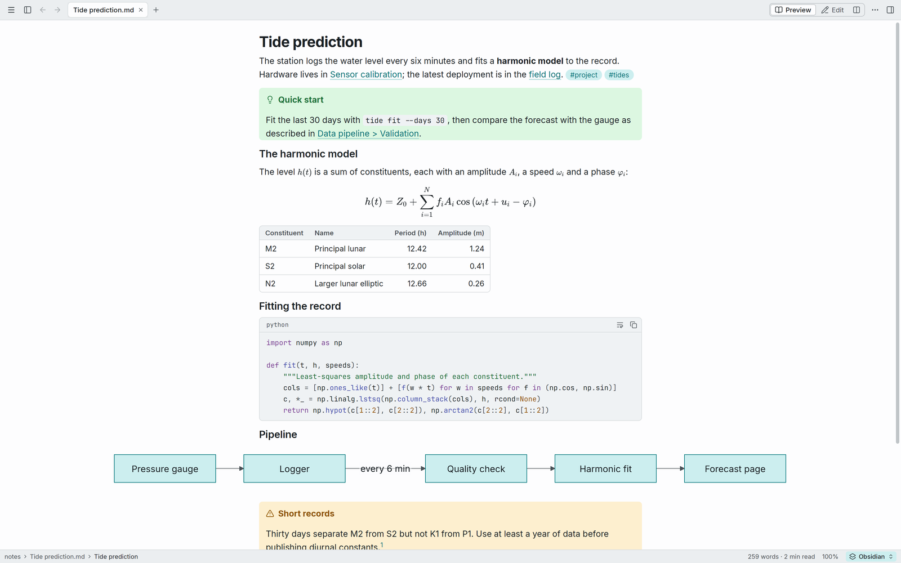

**Status:** 1.1 released. Download it from
[GitHub Releases](https://github.com/sorrelfox/glyphvane/releases): `.deb`,
`.rpm`, AppImage, Flatpak bundle and `.tar.gz` for Linux (x86_64 and arm64),
an Arch Linux package (x86_64), and `.msi` and `.zip` for Windows (x64 and
arm64). There are no macOS builds. Changes are
listed in [CHANGELOG.md](CHANGELOG.md).

```sh
flatpak install --user Glyphvane-<version>-<arch>.flatpak    # Flatpak
sudo pacman -U glyphvane-<version>-1-x86_64.pkg.tar.zst      # Arch Linux
```

The Flatpak has access to your home folder, so links between notes keep
working outside the opened vault; it leaves updates to Flatpak and keeps its
settings in `~/.var/app/io.github.sorrelfox.Glyphvane/`.

## Screenshots

| | |
|---|---|
| 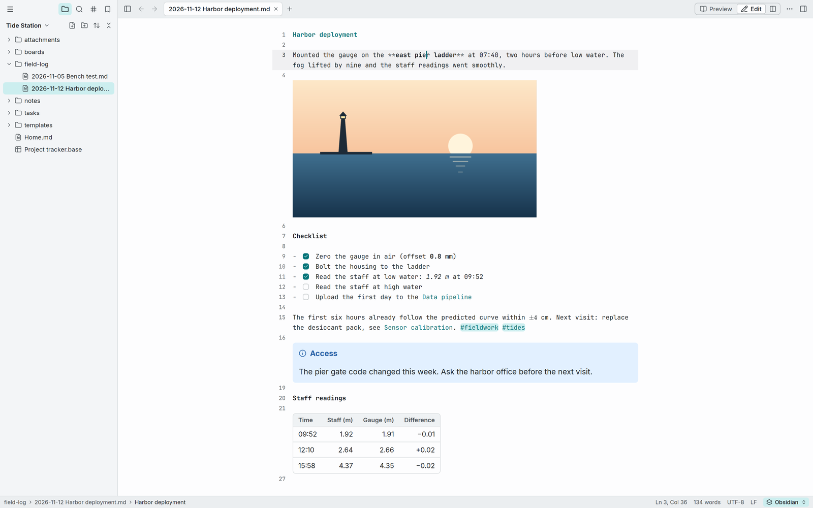<br>Live Preview: markup hides away from the cursor, and images, math, tables and code render in place | 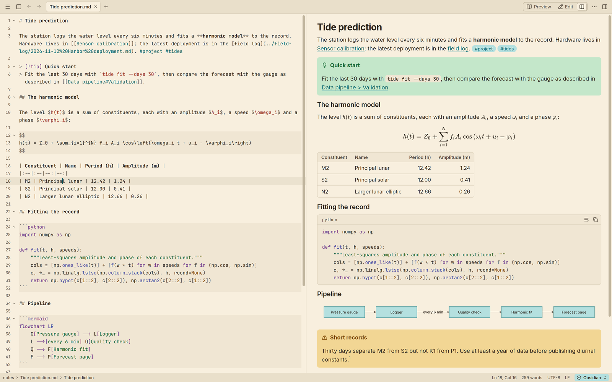<br>Source and preview side by side, scrolling together |
| 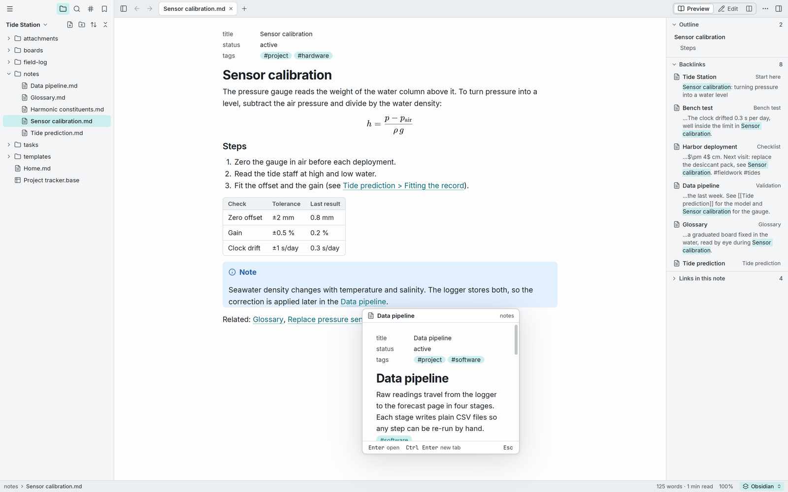<br>Work with a folder of notes: files, outline, backlinks and link previews | 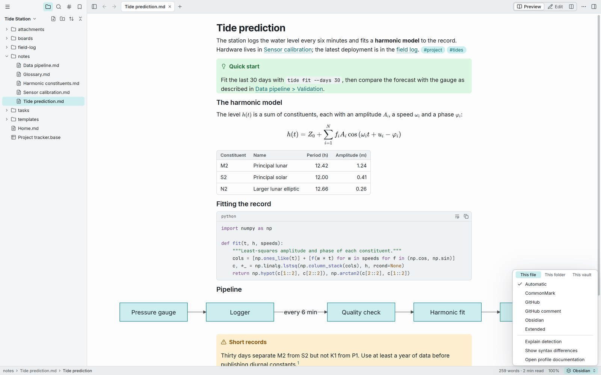<br>Render each document as CommonMark, GitHub Flavored Markdown, Obsidian or Extended |
| 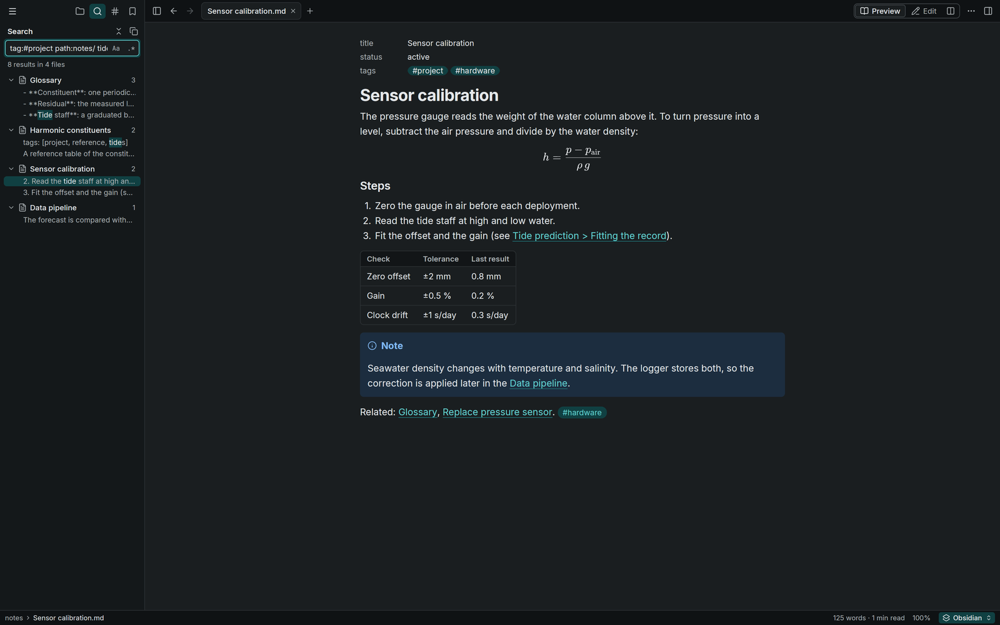<br>Search the whole folder with a query language | 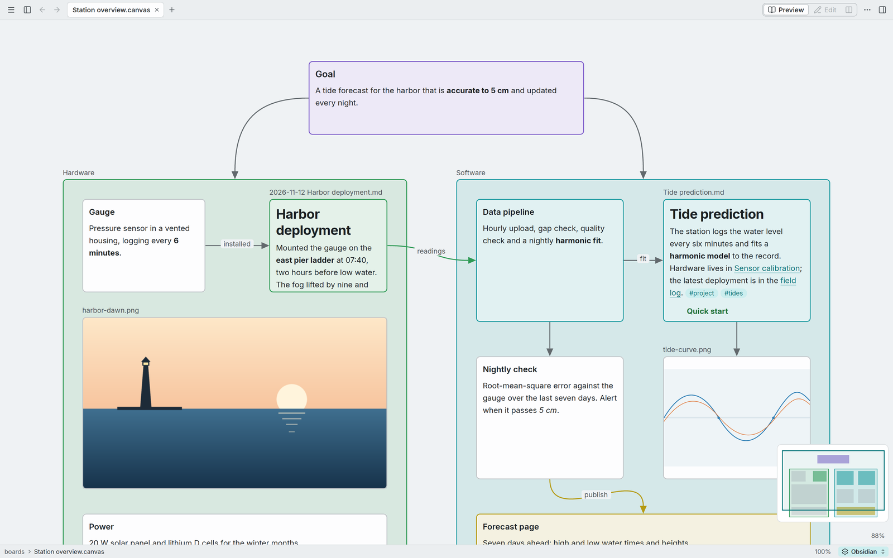<br>Open Obsidian canvases with cards, groups, edges and a minimap |
| 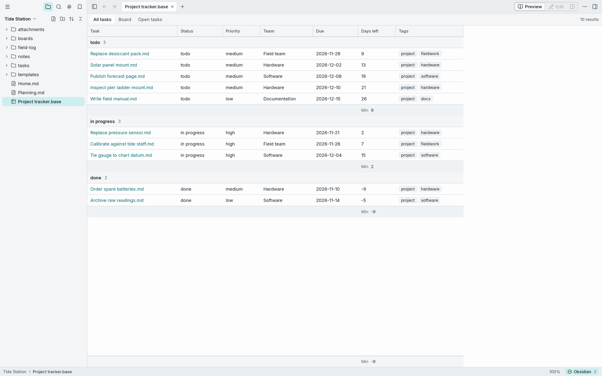<br>Bases show notes as tables, grouped and computed from their properties | 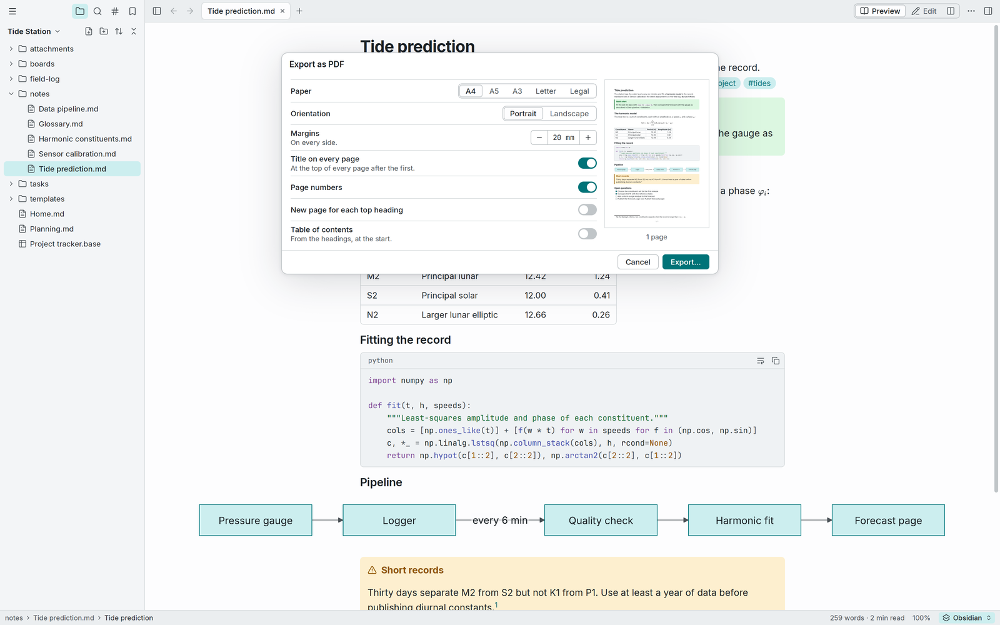<br>Export to HTML or PDF with page options and a live preview |
| 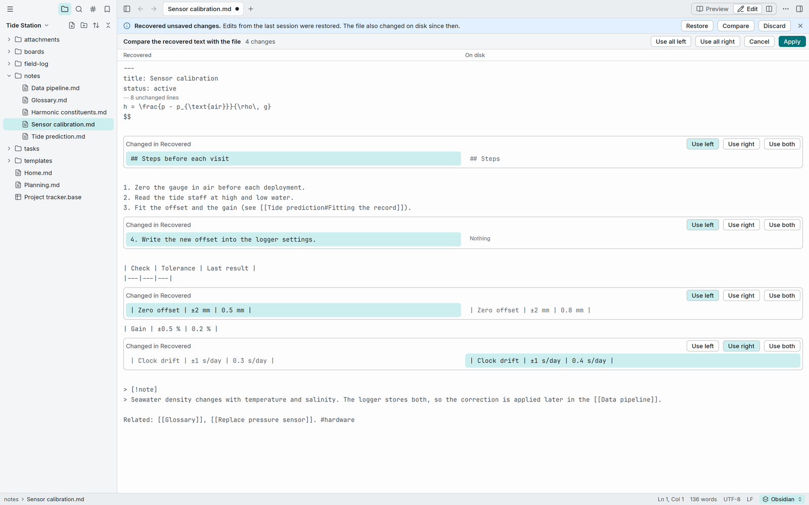<br>Recover unsaved work after a crash and merge it with the file on disk | 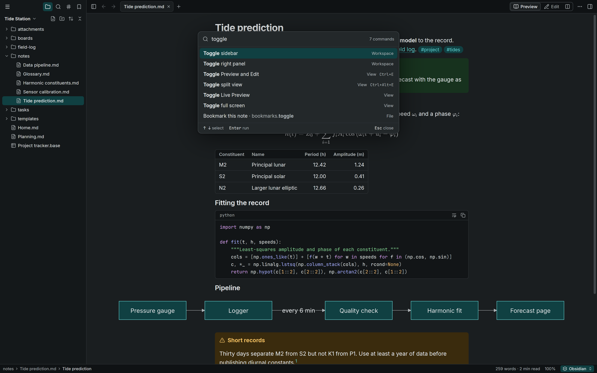<br>Every command is in the palette, in light or dark |

More about each feature, and texts for stores, in [docs/SHOWCASE.md](docs/SHOWCASE.md).

## Building from source

You need [rustup](https://rustup.rs/). The toolchain version is pinned in
`rust-toolchain.toml` and is installed automatically on the first build.

```sh
git clone https://github.com/sorrelfox/glyphvane.git
cd glyphvane
cargo build
```

On Linux, the GUI crates need some system development packages; see
[CONTRIBUTING.md](CONTRIBUTING.md#linux-system-packages). To run the same
checks as CI:

```sh
cargo xtask ci
```

Without opening a window, `glyphvane render notes.md -o notes.html` renders a
file to HTML (`--profile` picks the flavor), `glyphvane export --pdf notes.md`
writes a PDF, and `glyphvane check-links` checks the links of a note or a folder. Run
`glyphvane --help` for the full list.

## Contributing

See [CONTRIBUTING.md](CONTRIBUTING.md). Commits must be signed off under the
Developer Certificate of Origin. Please read the
[Code of Conduct](CODE_OF_CONDUCT.md), and report security issues as described
in [SECURITY.md](SECURITY.md).

## License

Glyphvane is free software: you can redistribute it and/or modify it under the
terms of the GNU General Public License as published by the Free Software
Foundation, either version 3 of the License, or (at your option) any later
version (`GPL-3.0-or-later`). See [LICENSE](LICENSE).
