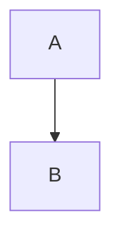

# Export fixture

Plain *emphasis*, **strong**, ***both***, ~~struck~~, `code`, and a [link](https://example.com "Example").
A [relative note](<notes/other note.md#Section>), an [anchor](#tables) and an [image file](img/dot.png).
An autolink <https://autolink.example>, an email <me@example.com>, and a hard  
break.

## Lists

- one
- two
  - nested

3. three
4. four

- [ ] open task
- [x] done task

> A quote with **strong** text.
>
> > A nested quote.

> [!NOTE]
> An alert with `code`.

> [!WARNING]
> Careful.

## Code

```rust
fn main() {
    let x = "<b>";
}
```

    indented <code>

## Math

Inline $a^2+b^2=c^2$ math.

$$
\frac{1}{2}
$$

## Diagram



## Tables

| Left | Center | Right |
|:-----|:------:|------:|
| a    | **b**  | `c`   |
| [x](#lists) | $y$ | |

## Footnotes

A note[^n] and again[^n], and another[^m].

[^n]: The footnote.
[^m]: Second footnote with *emphasis*.

## Images

 
 

## HTML

<div align="center" style="color: red; position: fixed"><b>bold</b> <script>alert(1)</script></div>

<p onclick="x()">click <a href="javascript:alert(1)">js</a> <a href="\\host\share">unc</a> <a id="top" href="#footnotes">ok</a></p>

<details>
<summary>More</summary>

Hidden *text*.

</details>

***

The end.
