# Glyphvane: feature showcase and store listing

This file holds the texts and the screenshot plan for presenting Glyphvane:
on the website or README, in release announcements, and in app stores
(Flathub, AUR, winget and others). It describes Glyphvane 1.1.

Screenshots go in [`docs/screenshots/`](screenshots/) under the file names
used below. Until they are taken, the image links below show as missing.

---

## Names and short texts

| Field | Text |
|---|---|
| Name | Glyphvane |
| Summary (AppStream, at most 35 characters) | Markdown editor for linked notes |
| Tagline | Read, write and link Markdown notes, fast and native. |
| Generic name | Markdown Editor |
| Developer | Glyphvane contributors |
| License | GPL-3.0-or-later (metadata: CC0-1.0) |
| App ID | `io.github.sorrelfox.Glyphvane` |
| Homepage | https://github.com/sorrelfox/glyphvane |
| Bug tracker | https://github.com/sorrelfox/glyphvane/issues |
| Downloads | https://github.com/sorrelfox/glyphvane/releases |
| Platforms | Linux (x86_64, arm64), Windows 10/11 (x64, arm64) |
| Categories (freedesktop) | `Utility;TextEditor;` (also fits `Office;`) |
| Keywords | markdown, notes, editor, viewer, vault, wikilinks, obsidian, commonmark, gfm, live preview, knowledge base, zettelkasten |

### Short description (about 200 characters)

> Glyphvane is a fast, native Markdown editor and viewer for Linux and
> Windows. Write with Live Preview, follow links across a folder of notes,
> and read Obsidian, GitHub and CommonMark documents exactly as they render.

### Long description

> Glyphvane is a native, GPU-rendered Markdown editor and viewer for Linux and
> Windows. It opens a single file or a whole folder of notes (a "vault") and
> starts in a moment, even with large documents.
>
> **Write the way you like.** Switch between the Reading view, the Source
> view and a Split view with synchronised scrolling. Live Preview hides
> Markdown markup away from the cursor and draws images, math, task
> checkboxes, tables, code blocks, diagrams and callouts right in the editor.
>
> **Links that just work.** Relative links, wikilinks, links to headings and
> block references resolve across the whole folder. Hover a link to preview
> its target, see backlinks and unlinked mentions, and let Glyphvane update
> every link when you rename or move a note. The link checker finds broken
> links before your readers do.
>
> **Every flavor, rendered right.** Each document is rendered by a selectable
> flavor profile: CommonMark, GitHub Flavored Markdown, Obsidian or Extended.
> Tables, footnotes, alerts and callouts, math, Mermaid diagrams, highlighted
> code, front matter and embeds all render as their flavor defines them.
>
> **Your notes, organised.** A Files panel, outline, tags, bookmarks, search
> with a query language, a quick switcher and a command palette. Canvas and
> Bases files from Obsidian open read-only, on their own or embedded in a
> note. Daily notes, templates, version history and Git status are built in.
>
> **Share and print.** Export to a standalone HTML file or to PDF with bundled
> fonts, print, or copy as rich text.
>
> **Safe with your files.** Autosave, crash recovery with a compare and merge
> view, handling of changes made by other programs and sync tools, and links
> updated with undo. Remote images and media load only when you allow them.
>
> Glyphvane is free software under the GNU GPL, version 3 or later.

---

## Feature highlights

Each section has a screenshot. The captions in *italics* are written to be
used as AppStream or store captions.

### 1. Reading view

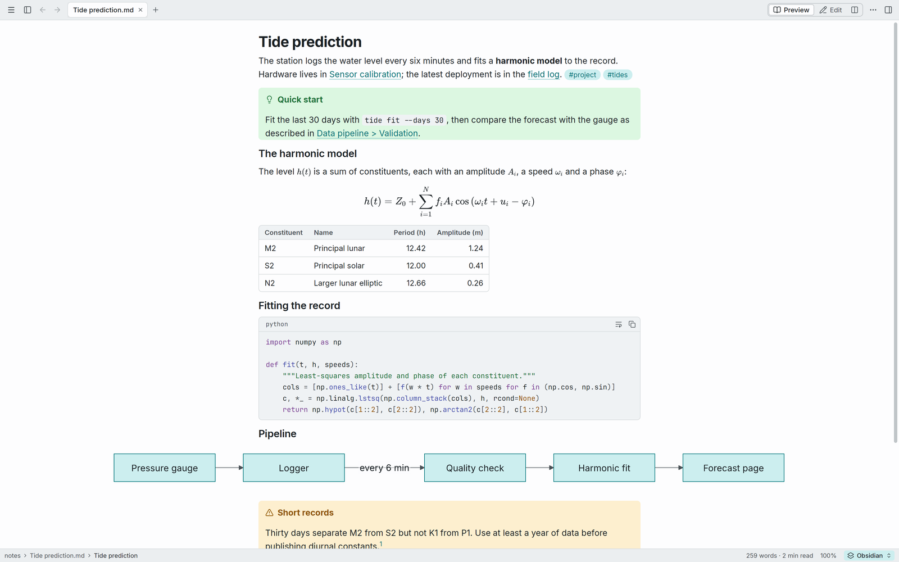

*A note in the Reading view, with a table, highlighted code, math and a Mermaid diagram.*

- GPU-rendered, smooth scrolling, even for very large documents.
- Tables, task lists, footnotes, alerts, callouts and `<details>`, pictures,
  front matter, math, Mermaid diagrams and highlighted code blocks.
- Wide tables, diagrams and math fit the column, grow beside it, or open in
  a view over the window.
- Light, Semi-light and Dark themes that follow the system, and zoom from
  50 % to 300 % that is kept between launches.

### 2. Live Preview

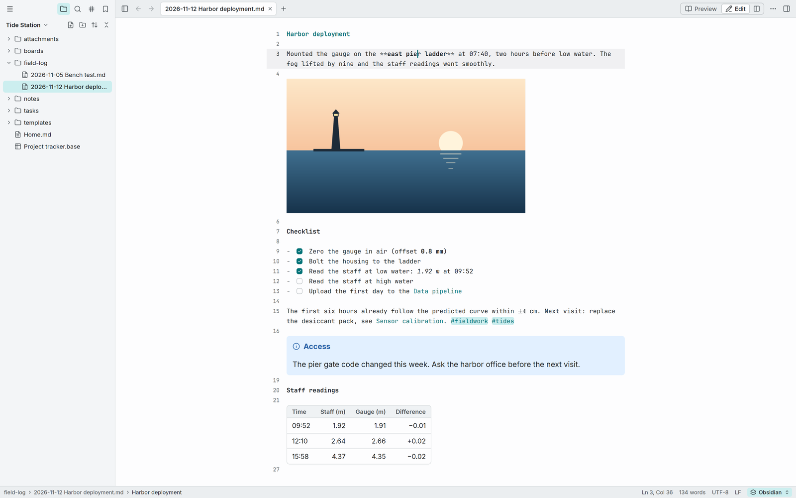

*Live Preview: markup hides away from the cursor, and images, math, tables and code render in place.*

- Markers such as `**`, `_`, backticks, link syntax and heading `#` are hidden
  except where the cursor or a selection touches them.
- Inline widgets: images, inline math, clickable task checkboxes, emoji
  shortcodes and tags.
- Block widgets: code blocks, tables, display math, diagrams, embeds,
  callouts, horizontal rules, front matter and images.
- A block shows its source when the cursor enters it; links in blocks follow
  with Ctrl+click.

### 3. Split view

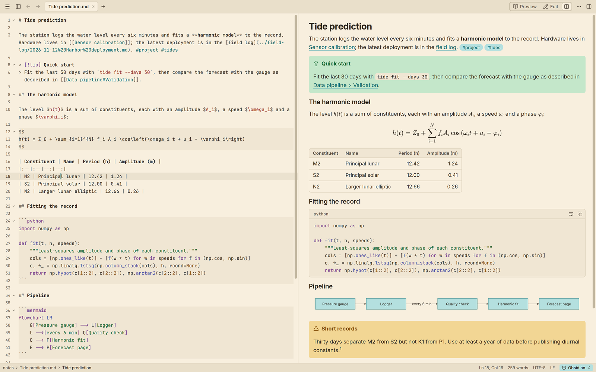

*Source and preview side by side, scrolling together.*

- Source editing with syntax highlighting, folding, soft wrap, autocomplete,
  smart pairs, multiple cursors, find and replace, and spell check.
- Editing commands for lists, tables, footnotes and line operations.
- Smart paste turns HTML from the clipboard into Markdown.
- Text and code files open in a plain-text editing mode.

### 4. A folder of linked notes

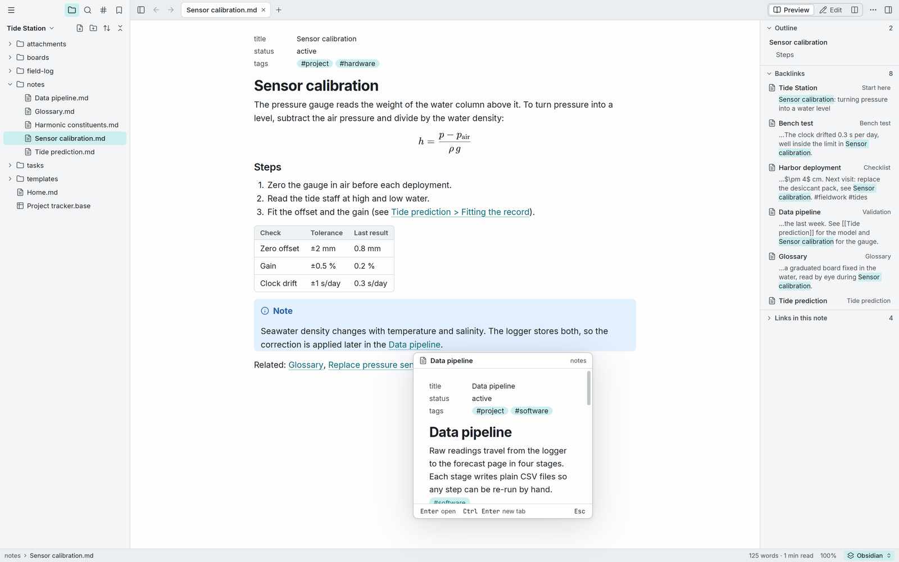

*Work with a folder of notes: files, outline, backlinks and link previews.*

- Relative links, wikilinks, heading links and block references resolve
  across the folder.
- Hover previews, backlinks, unlinked mentions and outgoing links.
- Rename, move, duplicate or delete files from the Files panel; links are
  updated, with undo. Renaming a heading or a block id updates its links too.
- Drag files in from the file manager, paste images, and drop files into
  notes as links.

### 5. Flavor profiles

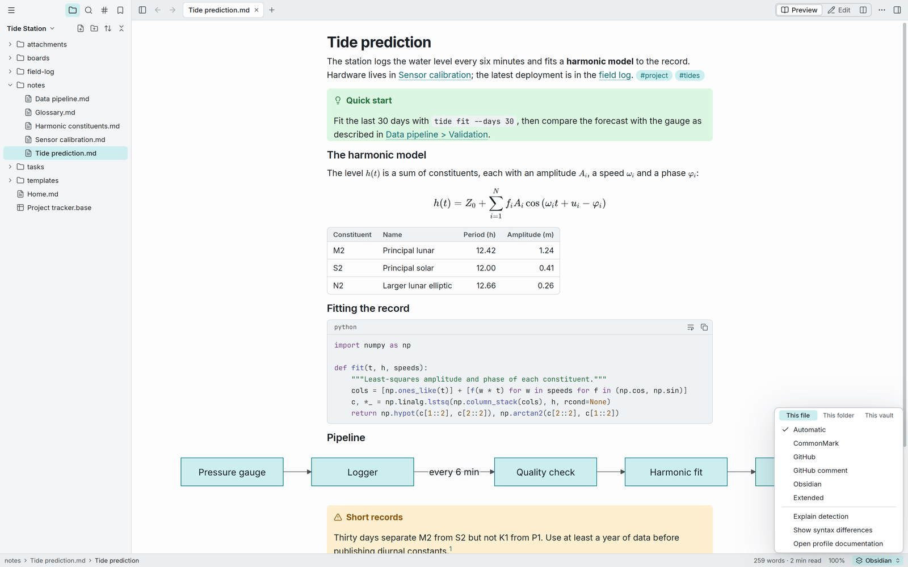

*Render each document as CommonMark, GitHub Flavored Markdown, Obsidian or Extended.*

- A lossless, incremental parser tested against the CommonMark and GFM
  specifications.
- The profile decides what renders: wikilinks, callouts, comments,
  highlights, math, footnotes, front matter and more.
- Show syntax differences to see where flavors disagree on a document.

### 6. Search and navigation

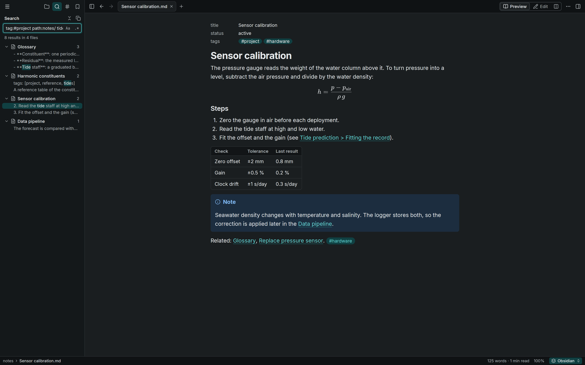

*Search the whole folder with a query language; jump anywhere with the quick switcher.*

- Vault search with operators (`path:`, `file:`, `tag:`, `line:`,
  `section:`, `block:`, `task:` and more), regular expressions and case
  options.
- Quick switcher, command palette, Go to line and Go to heading.
- Tags panel, bookmarks, recent files and Back/Forward history.

### 7. Canvas and Bases

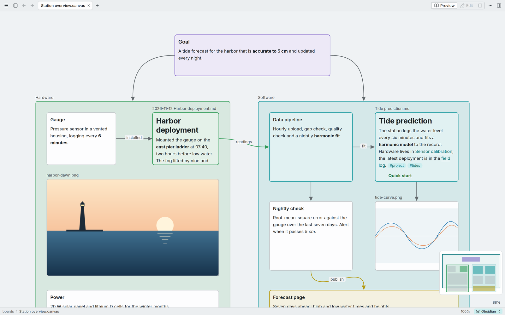

*Open Obsidian canvases with cards, groups, edges and a minimap.*

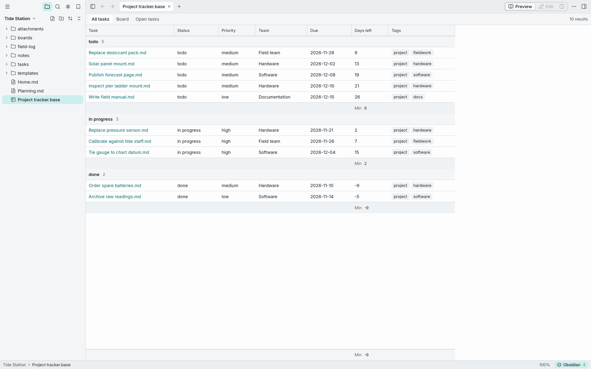

*Bases show notes as tables or cards, filtered and sorted by their properties.*

- Canvas files open read-only, with pan, zoom, zoom to fit, a minimap and PDF
  and image cards.
- Base files evaluate their filters and formulas over the folder, in a tab or
  in the sidebar, and follow the active note.
- Both can be embedded in notes.

### 8. Export, print and share

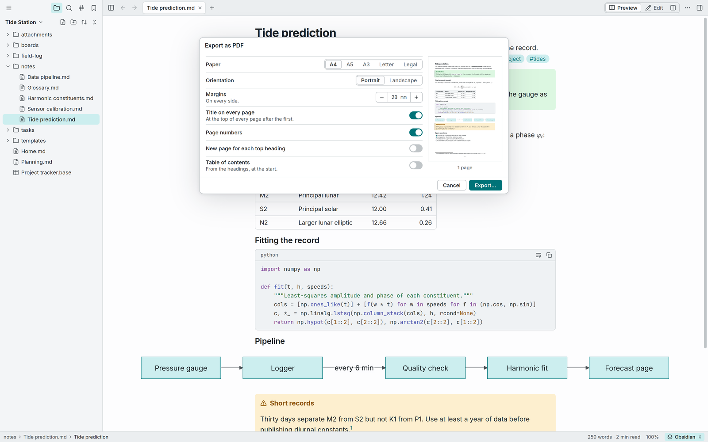

*Export to HTML or PDF with page options and a live preview.*

- Standalone HTML with images included, or a folder of assets.
- PDF with paper, margins, page numbers, headers, a table of contents and
  bundled fonts, so it looks the same everywhere.
- Print through the system dialog; copy as rich text or as Markdown.

### 9. Safe with your files

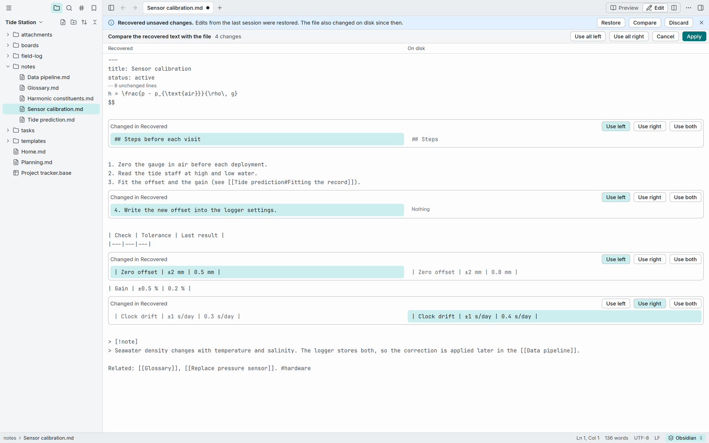

*Recover unsaved work after a crash and merge it with the file on disk.*

- Autosave and a journal of unsaved changes that survives crashes.
- Changes made by other programs, sync conflicts and Git conflict markers are
  detected and offered for comparison and merging.
- Version history of every file, and a trust prompt for new folders:
  remote images and media load only after you allow them.

### 10. Made for the keyboard, and for everyone

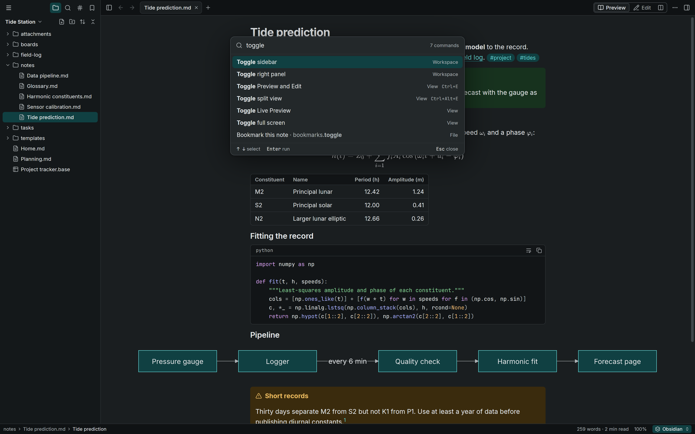

*Every command is in the palette and the keymap editor, in light or dark.*

- A keymap editor and a shortcut cheat sheet.
- Screen-reader support (AccessKit): named controls, document structure in
  the Reading view, and the editor's text, caret and selection.
- Full keyboard reach, visible focus, reduced motion and scalable interface
  text.

### For the command line

- `glyphvane render notes.md -o notes.html`: render a file to HTML.
- `glyphvane export --pdf notes.md`: write a PDF.
- `glyphvane check-links <note-or-folder>`: check links, with exit codes for
  scripts and CI.
- `glyphvane --wait file.md`: use Glyphvane as `$EDITOR` for Git and other
  tools.

---

## Screenshot plan

| File | What to show | Theme | Notes |
|---|---|---|---|
| `01-reading-view.png` | A rich note in Preview: heading, table, code block, inline and display math, a Mermaid diagram, a callout | Light | Hero image; sidebar closed |
| `02-live-preview.png` | Edit mode with Live Preview: the cursor inside a bold phrase (markers shown), the rest rendered; a checkbox list and an image | Light | Show one revealed construct |
| `03-split-view.png` | Split view of the same note, source on the left, preview on the right | Semi-light | Scroll to a section with a table |
| `04-vault-links.png` | Files panel open, a link hover preview, the Links panel with backlinks on the right | Light | Use a small demo vault with readable names |
| `05-flavor-profiles.png` | The profile chip menu open in the status bar | Light | Crop to the lower half if needed |
| `06-search.png` | Search panel with a query such as `tag:#project path:notes/` and results | Dark | |
| `07-canvas.png` | A canvas with text, note and image cards, a group, edges and the minimap | Light | |
| `08-bases.png` | A base as a table, plus the cards view if it fits | Light | |
| `09-export-pdf.png` | The export dialog with the PDF preview of the first page | Light | |
| `10-recovery.png` | The compare and merge view with a few changes | Light | |
| `11-dark-palette.png` | Dark theme, command palette open over a note | Dark | |

How to take them:

- **Size:** a 1600 × 1000 window (16:10) or 1600 × 900 (16:9). The same size
  for every image. Export PNG.
- **Content:** a demo vault with neutral, readable content in English. No
  personal names, paths or private notes. A clean home folder name helps
  (the title bar shows paths).
- **Settings:** default fonts, zoom 100 %, interface size default, no
  notifications or infobars unless they are the subject.
- **Window:** capture the window only, without the desktop around it. Check
  each store's current guidelines on window shadows and borders before
  uploading.
- **Run with a test configuration** so your own settings stay untouched:
  `glyphvane --config-dir /tmp/glyphvane-demo ~/demo-vault`.

---

## Store notes

### Flathub (AppStream metainfo)

Screenshots are listed in `packaging/linux/io.github.sorrelfox.Glyphvane.metainfo.xml`
with stable URLs (for example raw files from a tagged release in this
repository) and a caption each. The first one is the default.

```xml
<screenshots>
  <screenshot type="default">
    <caption>A note in the Reading view, with a table, highlighted code, math and a Mermaid diagram</caption>
    <image>https://raw.githubusercontent.com/sorrelfox/glyphvane/v1.1.0/docs/screenshots/01-reading-view.png</image>
  </screenshot>
  <screenshot>
    <caption>Live Preview: markup hides away from the cursor</caption>
    <image>https://raw.githubusercontent.com/sorrelfox/glyphvane/v1.1.0/docs/screenshots/02-live-preview.png</image>
  </screenshot>
</screenshots>
```

Before submitting:

- Expand `<description>` in the metainfo with the long description above
  (paragraphs and a `<ul>` of highlights; AppStream allows only `p`, `ul`,
  `ol`, `li`, `em` and `code`).
- Set the summary to the 35-character line above.
- Add `<branding>` colours, `<content_rating type="oars-1.1"/>` (already
  present) and `<keywords>`.
- Run `appstreamcli validate --explain` and check Flathub's current quality
  guidelines for screenshots and texts.
- Flathub builds from source: its manifest needs vendored Cargo sources
  (the bundle manifest in `packaging/flatpak/` repackages release binaries).
- Permission to explain in the listing: `--filesystem=home`, so links
  between notes keep working outside the opened folder.

### Arch User Repository

- Package `glyphvane-bin` from `packaging/arch/PKGBUILD`.
- Description (`pkgdesc`): `Native Markdown editor and viewer for linked notes`.

### Windows (winget, Microsoft Store)

- Short description: the summary or the tagline.
- Description: the long description, with the highlights as a list.
- Screenshots: the same images; desktop stores usually require at least
  1366 × 768, so take them at 1600 × 1000 or larger.
- The builds are not code-signed yet: SmartScreen shows a warning on first
  run until they are.

---

## Privacy statement (for store forms)

- Glyphvane collects no telemetry and sends no personal data.
- It connects to the network only to load remote images and media in notes,
  and only for folders and sites you allow (the trust prompt, Ask/Allow/Block,
  and Restricted mode).
- The update check is optional and asks first: it asks GitHub
  (`api.github.com`) which release is the newest and links to its page. It
  installs nothing and is off in the Flatpak, where Flatpak handles updates.
- Settings, history, crash reports and recovery data stay on your computer.
