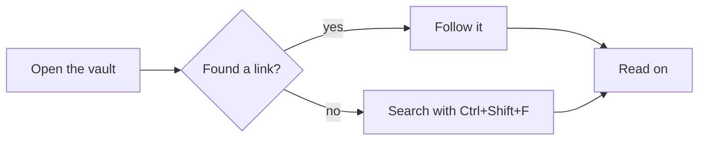
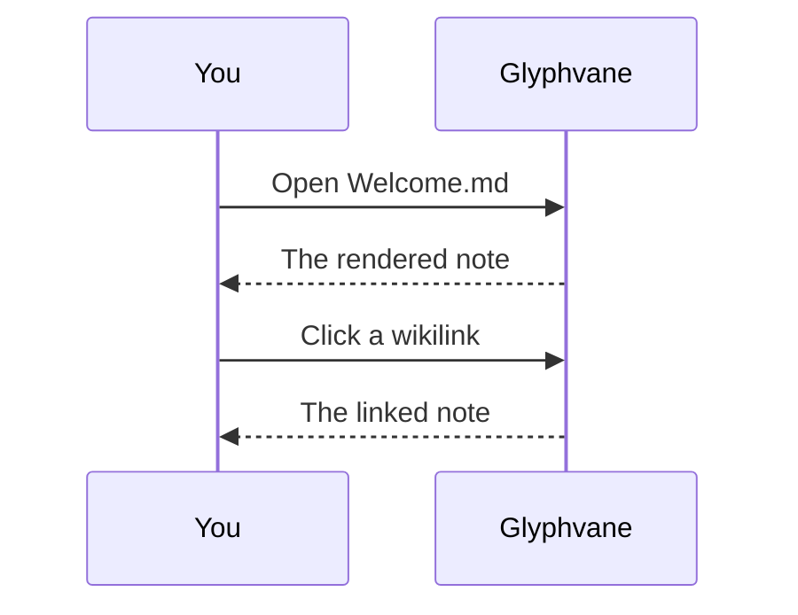
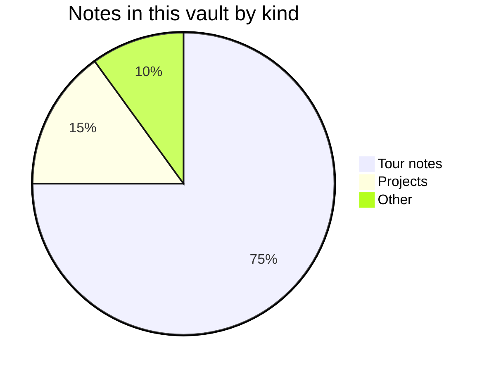

# Diagrams

A code block in the `mermaid` language is drawn as a diagram. Back to
[[Welcome]].

## Flowchart

## Sequence

## Pie

Flowcharts, sequence, class, state, Gantt, pie, mind map and many other
diagram types are supported. A diagram that cannot be drawn shows its source.
