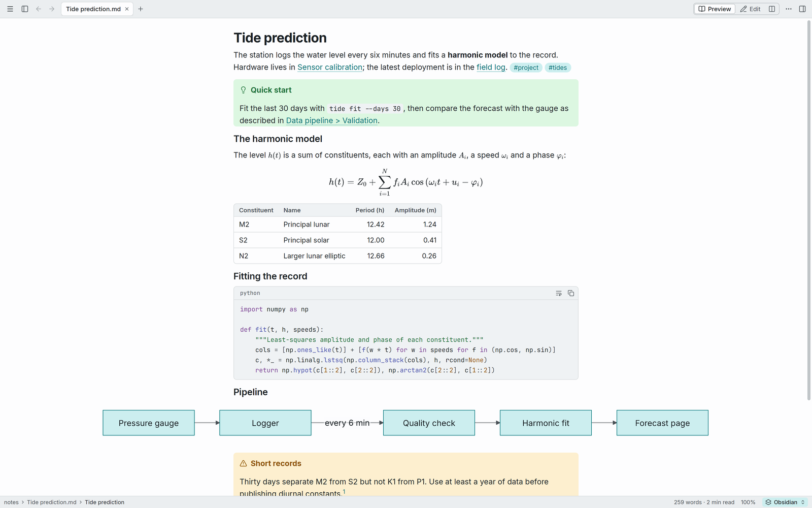

# Glyphvane user guide

Glyphvane is a fast, native Markdown editor and viewer for Linux and Windows.
It opens a single file or a whole folder of notes (a *vault*), follows
relative links, wikilinks, heading links and block references across that
folder, and renders each document the way its flavor defines it: CommonMark,
GitHub, Obsidian or Extended. You can read in the Reading view, write in the
editor with Live Preview, or use both side by side.

This guide describes Glyphvane 1.1. Shortcuts are written with **Ctrl**; they
are the same on Linux and Windows. macOS is not supported.

## Contents

| Page | What it covers |
|---|---|
| [Getting started](getting-started.md) | Installing each package, the first start, opening files and folders, the parts of the window |
| [Reading and editing](reading-and-editing.md) | Preview, Edit and Split, Live Preview, lists, tables, multiple cursors, folding, find and replace, autocomplete, spell check, zoom |
| [Markdown and profiles](markdown-and-profiles.md) | What renders, the flavor profiles and how one is chosen, `.glyphvane.toml`, syntax differences |
| [Links and vaults](links-and-vaults.md) | Kinds of links and embeds, hover previews, backlinks, renaming with link updates, the link checker, attachments, trust and remote content |
| [Search and navigation](search-and-navigation.md) | Vault search and its query syntax, quick switcher, command palette, Go to, outline, tags, bookmarks, history, daily notes, templates |
| [Canvas and Bases](canvas-and-bases.md) | Viewing Obsidian canvases and bases, their keys, and the supported base expressions |
| [Files and safety](files-and-safety.md) | Autosave, crash recovery, compare and merge, changes on disk, sync conflicts, version history, trash, Git status |
| [Export and print](export-and-print.md) | HTML and PDF export options, printing, copying as rich text, opening in a browser |
| [PDFs, images and media](pdf-and-media.md) | The PDF, image and text viewers, audio and video |
| [Settings and shortcuts](settings-and-shortcuts.md) | The settings window, where settings are stored, import and export, the keymap editor and `keymap.toml`, every default shortcut |
| [The command line](command-line.md) | `glyphvane` options, `--wait` as `$EDITOR`, `render`, `export` and `check-links` |
| [Accessibility](accessibility.md) | Keyboard use, screen readers, reduced motion, themes and interface size |
| [Privacy](privacy.md) | When Glyphvane uses the network, what it stores, Flatpak permissions |
| [Troubleshooting](troubleshooting.md) | Graphics problems and safe mode, Flatpak, SmartScreen, fonts, logs, reporting a bug |

## Help inside the app

- **Help ▸ Documentation** opens this guide.
- **Help ▸ Keyboard shortcuts** shows the keys in effect.
- **Ctrl+P** opens the command palette, which lists every command you can run
  where you are.
- **Help ▸ Copy debug info** copies what a bug report needs; see
  [Troubleshooting](troubleshooting.md#reporting-a-bug).
