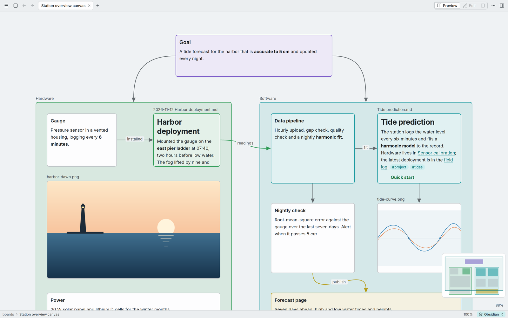
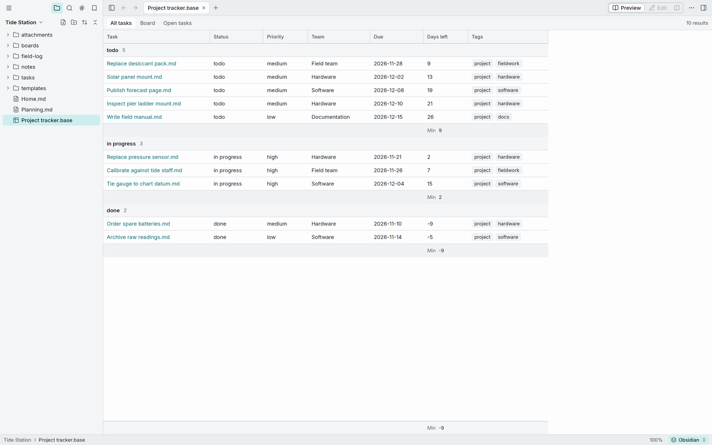

# Canvas and Bases

Glyphvane opens Obsidian's `.canvas` and `.base` files. Both are
**read-only**: you can look at them, follow their links and embed them in
notes, but Glyphvane never changes them. A canvas or base tab has no Edit or
Split mode, and it reloads when the file changes on disk.

## Canvas

A canvas is a board of cards connected by arrows.



### What is shown

- **Text cards** render their Markdown as the Reading view does: formulas
  are typeset, code blocks are highlighted and Mermaid diagrams are drawn.
  A diagram shows its source until it is drawn, or when it cannot be drawn.
  HTML shows as in the Reading view: a `<details>` element shows its
  summary, and its content only when it has `open` (a card cannot open
  it); other HTML blocks show their source, marked *html*. A search query
  (` ```query `) lists its first five notes and how many more there are; a
  base (` ```base ` or an embedded `.base` file) shows the first rows and
  columns of its view; embedded PDFs, audio, video and web pages show a
  card saying what they are (nothing is played or loaded). They fill in once
  the vault is indexed and follow its changes. Zoomed out, and for embedded
  canvases, a small card names them instead, such as *Base: Tasks.base*. A
  folded callout (`> [!note]-`) shows only its title. Images inside the
  text are not drawn.
- **File cards** show the file: the first blocks of a note (or the heading or
  block the card points to), drawn like a text card, an image, the first
  page of a PDF, or the shapes of another canvas. Other files show as a
  plain card. Missing files, and files outside the vault, say so.
- **Link cards** show their web address. Nothing is downloaded.
- **Groups**, with their label and an optional background image (only local
  images).
- **Arrows** between cards, with labels, arrowheads and colours. The six
  preset colours follow the theme; other colours are used as given.

Cards with a problem get a warning mark; the problems button at the bottom
left lists them.

### Moving around

| Mouse | What it does |
|---|---|
| Drag, mouse wheel or trackpad | Pan |
| **Ctrl+wheel** or pinch | Zoom at the pointer |
| Click a card | Select it |
| Click a file card | Open the file (**Ctrl+click** for a new tab, **Ctrl+Alt+Shift+click** for a new window, middle click for a background tab) |
| Click a link card | Open the web address |
| Click a note or row in a query or base, or a media card | Open it (**Ctrl+click** for a new tab, **Ctrl+Alt+Shift+click** for a new window) |

| Key | What it does |
|---|---|
| **Tab** / **Shift+Tab** | Next / previous card |
| Arrow keys | Select the nearest card in that direction |
| **Enter** | Open the selected card |
| **Ctrl+Enter** | Open the selected card in a new tab |
| **Shift+Arrow keys** | Pan |
| **Shift+1** or **Home** | Zoom to fit (also View ▸ Zoom to fit) |
| **Ctrl+=** / **Ctrl+-** | Zoom in / out |
| **Ctrl+0** | Zoom to 100 % |
| **Esc** | Clear the selection |

The canvas fits the window when it opens, and you can zoom from 5 % to 400 %.
Moving to a card that is out of view is animated, unless your system asks
for reduced motion.

**Minimap.** When part of the canvas is out of view (and the window is big
enough), a minimap appears at the bottom right. Click or drag in it to move
the view.

### Canvas embeds

`![[Board.canvas]]` in a note shows the whole canvas, fitted to the width of
the text. Click it to open the canvas.

## Bases

A base (`.base` file) is a saved view of the notes in a vault: it filters
them by their properties and shows them as a table, cards or a list, with
computed columns (formulas) and summaries.



A base can appear:

- in a tab of its own, when you open the `.base` file;
- embedded in a note, with `![[Tasks.base]]` or `![[Tasks.base#View name]]`;
- inside a note as a ` ```base ` code block holding the base's YAML;
- in the right panel, as the [sidebar base](#the-sidebar-base).

Press **]** and **[** to switch to the next or previous view of the base.

| Key (with the base focused) | What it does |
|---|---|
| **Up** / **Down** | Previous / next row of a table or list |
| **Home** / **End** | First / last row |
| **Page Up** / **Page Down** | Ten rows up / down |
| **Left** / **Right** | Previous / next cell of the row (tables) |
| **Enter** | Open the row's file |
| **Ctrl+Enter** | Open the row's file in a new tab |

The base itself is a Tab stop (except a base embedded in a note); in the
cards layout each card is a Tab stop, and **Enter** opens it.
Click a link, a file or a web address in a cell to open it (**Ctrl+click**
for a new tab, **Ctrl+Alt+Shift+click** for a new window, middle click for a
background tab).

### What is supported

| Part of the file | Supported |
|---|---|
| `filters` | An expression, or `and`, `or` and `not` over lists of filters. The base's filters and the view's filters both apply |
| `formulas` | Named expressions, used as `formula.name` |
| `properties` | `displayName` for column titles |
| `summaries` | Custom summaries, as expressions over `values` |
| `views` | `table`, `cards` and `list` layouts, with `filters`, `order` (the columns), `sort`, `groupBy`, `groupOrder` and `limit` |
| Table views | Column widths (`columnSize`), group headers with summaries, a summary row |
| Cards views | `cardSize`, and a cover image from `image`, with `imageFit` (`cover` or `contain`) and `imageAspectRatio` |

Other layouts (map, kanban, plugin layouts) are shown as a table, with a note
saying so. A base without views shows a table of file names. When a `limit`
cuts the list short, the count shows how many of the matching notes are
shown.

**Built-in summaries:** Average, Min, Max, Sum, Range, Median, Stddev,
Earliest, Latest, Checked, Unchecked, Empty, Filled and Unique.

### Expressions

Filters, formulas and summaries are expressions, as in Obsidian.

**Values you can use:**

- `name` or `note.name`: a front matter property of the note;
- `formula.name`: a formula of the base;
- `file.name`, `file.basename`, `file.path`, `file.folder`, `file.ext`,
  `file.size`, `file.ctime`, `file.mtime`, `file.tags`, `file.links`,
  `file.embeds`, `file.backlinks`, `file.properties`;
- `this`: the base file itself, or the note that embeds the base, or the
  active note for a [sidebar base](#the-sidebar-base).

**Operators:** `+ - * / %`, `== != < <= > >=`, `!`, `&&`, `||`, indexing
(`list[0]`, `object["key"]`), and lists `[…]` and objects `{…}` as literals.
A date plus or minus a duration string works (`now() - "2h"`), and two dates
subtract to a duration. Duration units are `y`, `M` (month), `w`, `d`, `h`,
`m` (minute) and `s`, or the words for them.

**Functions:**

| On | Functions |
|---|---|
| Global | `if(condition, then, else)`, `link()`, `list()`, `date()`, `duration()`, `now()`, `today()`, `number()`, `file()`, `max()`, `min()`, `escapeHTML()`, `html()`, `image()`, `icon()` |
| Any value | `isTruthy()`, `isType()`, `toString()`, `isEmpty()` |
| Text | `contains()`, `containsAll()`, `containsAny()`, `startsWith()`, `endsWith()`, `lower()`, `upper()`, `title()`, `trim()`, `replace()`, `repeat()`, `reverse()`, `slice()`, `split()`, `length` |
| Numbers | `abs()`, `ceil()`, `floor()`, `round()`, `toFixed()` |
| Lists | `contains()`, `containsAll()`, `containsAny()`, `filter()`, `map()`, `reduce()`, `flat()`, `join()`, `reverse()`, `slice()`, `sort()`, `unique()`, `length`, `mean()`, `median()`, `sum()`, `min()`, `max()` |
| Dates | `date()`, `time()`, `format()` (Moment.js tokens), `relative()` ("3 days ago"), `year`, `month`, `day` and the other date fields |
| Durations | `days`, `hours`, `minutes`, `seconds`, `milliseconds` |
| Files | `asLink()`, `hasLink()`, `hasProperty()`, `hasTag()`, `inFolder()` |
| Links | `asFile()`, `linksTo()`, and the fields of the linked file |
| Objects | `keys()`, `values()` |

- In `filter()`, `map()` and `reduce()`, use `value` and `index` (and `acc`
  in `reduce()`).
- `hasTag()` ignores letter case and the leading `#`, includes nested tags,
  and takes several tags (any of them matches).
- `inFolder()` includes subfolders.
- `replace()` and `split()` take plain text; regular expressions are not
  supported.

**When something goes wrong,** only the cell is affected: it shows
"Error: …", with the full message as a tooltip. A function that is not
supported gives `Unsupported function: name()`. A filter that fails for one
note leaves that note out. The problems button lists syntax errors and
problems with the number of notes affected. A base stops evaluating after 5
seconds or 100,000 rows.

### The sidebar base

View ▸ Base (*Show base in sidebar*) shows a base in the right panel. Pick
the base from the list at the top and its view from the view tabs. In the
sidebar, `this` is the note in the active tab, and the base updates whenever
you switch tabs. That makes bases such as "notes that link here" possible:

```yaml
filters: file.hasLink(this.file)
```

The window remembers the base, its view and whether the section is folded.
