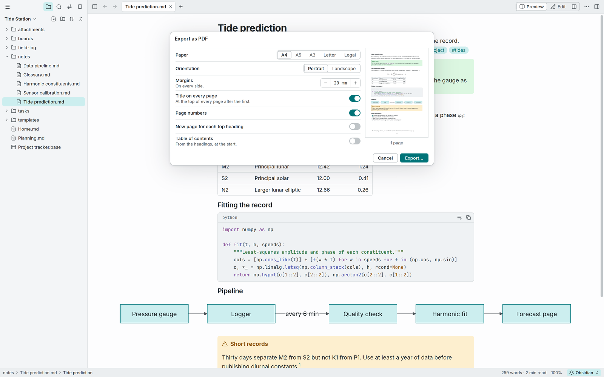

# Export and print

The File menu has **Export as HTML…**, **Export as PDF…**, **Open in browser**
and **Print…**. Each export opens an options dialog; the choices you make are
remembered until you quit.

## HTML

Export as HTML writes one standalone page in the light theme.

| Option | Choices |
|---|---|
| **Images** | **In the file** (the default): images are included in the page itself. **In a folder**: images are copied to an `assets` folder beside the page |
| **Embed remote images** | Off by default. When on, remote images that your remote-content setting allows are included; the others stay links |
| **Table of contents** | Off by default. Adds a table of contents from the headings, at the start |

Links to other notes point to their `.html` files, so you can export several
notes and keep them linked.

## PDF

Export as PDF makes the PDF with bundled fonts, so it looks the same on every
computer. Headings become PDF bookmarks, and links work.

| Option | Choices |
|---|---|
| **Paper** | A4 (the default), A5, A3, Letter, Legal |
| **Orientation** | Portrait (the default), Landscape |
| **Margins** | 5 to 60 mm on every side, in 5 mm steps (20 mm by default) |
| **Title on every page** | At the top of every page after the first (on by default) |
| **Page numbers** | On by default |
| **New page for each top heading** | Off by default |
| **Table of contents** | From the headings, at the start |

The dialog shows a live preview of the first page and the number of pages.

PDFs are made by the `glyphvane-helper` program that comes with Glyphvane. To
export from a script, use [`glyphvane export --pdf`](command-line.md#glyphvane-export).

## Print

**Print…** opens a dialog with the same options as the PDF export, except
paper, orientation and margins, which you choose in the system's print dialog
next.

- **Linux:** the desktop's print dialog (GNOME or KDE), through the desktop
  portal.
- **Windows:** the Windows print dialog.

If printing is not available, Glyphvane opens the PDF in your PDF viewer so
you can print it from there.

## Open in browser

**Open in browser** exports the note as HTML with the default choices (images
in the file, no table of contents) to a new private temporary folder, and
opens it in your default browser.

## Copy as rich text or Markdown

- **Edit ▸ Copy as rich text** copies the selection as formatted text, for pasting into word processors and mail. It also puts
  plain text on the clipboard for programs that do not take formatting. If
  the clipboard cannot hold formatted text, Glyphvane copies plain text and
  tells you.
- **Edit ▸ Copy as Markdown** copies the Markdown source of what you selected
  in the Reading view. In the editor, it is the same as Copy.
- **Edit ▸ Copy link to heading** copies a link to the heading or block at the
  cursor.
