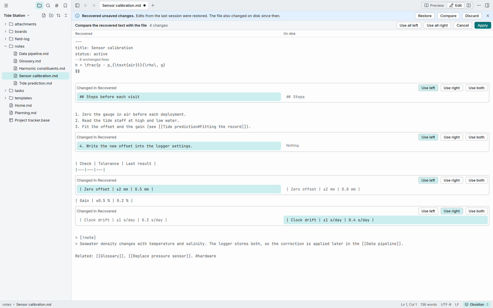

# Files and safety

Glyphvane is built to never lose your text: it saves for you, keeps a journal
of unsaved changes, notices when other programs change your files, and keeps
earlier versions of every note.

## Saving and autosave

**Ctrl+S** saves and **Ctrl+Shift+S** saves under a new name. File ▸ Revert
goes back to the saved file, after asking.

Autosave is on by default (the **Autosave** setting). It saves a second after
you stop typing, when the window loses focus, when you switch tabs and when you
quit. It waits while you are composing text with an input method, and while a
conflict or recovery bar is open.

When you close a document with unsaved changes (an untitled note, or with
autosave off), Glyphvane asks **Save**, **Don't save** or **Cancel**.

## Recovery after a crash

Every edit is also written to a journal in Glyphvane's data folder. If the app
or the computer stops before a save, the next start reopens the document in
Edit mode with the bar **Recovered unsaved changes.** and three choices:

- **Restore** keeps the recovered text;
- **Compare** opens the [compare and merge view](#compare-and-merge);
- **Discard** drops the recovered changes.

Renames and moves that were interrupted are rolled back.

## Compare and merge

The compare view shows two versions side by side and lists each change. For
every change you can choose **Use left**, **Use right** or **Use both**; the
header has **Use all left**, **Use all right**, **Cancel** and **Apply**.
Applying is a single undoable edit, and nothing is written to disk until you
save.

## Changes made by other programs

Glyphvane watches open files:

- If a file changes on disk and you have no unsaved edits, it reloads the file
  as one undoable edit, so **Ctrl+Z** brings your version back.
- If you have unsaved edits, the bar **Changed on disk with unsaved edits.**
  offers **Compare**, **Keep mine** and **Take theirs**.
- If the file is deleted or moved by another program, the bar **Deleted on
  disk.** offers **Save**, **Save as…** and **Close**.

## Sync conflicts

Sync services create a copy of a file when two devices change it at the same
time. Glyphvane recognises these copies from:

- Dropbox (`conflicted copy` in the name);
- Syncthing (`.sync-conflict-` in the name);
- OneDrive (`name-COMPUTERNAME`) and iCloud (`name 2`), when the original file
  is next to the copy.

When a conflict copy appears next to an open file, a bar offers **Compare**
and **Open copy**. View ▸ Sync conflicts lists all conflict copies in the
vault, with **Compare**, **Open copy**, **Keep original** and **Use copy**.
The version you do not keep goes to the system trash. Conflict copies are not
used when links are resolved.

## Git conflict markers

When a note contains Git merge conflict markers (`<<<<<<<`, `=======`,
`>>>>>>>`), a bar says **This note has merge conflict markers.** Choose
**Resolve…** to open the compare view with your side ("ours") on the left and
the other side ("theirs") on the right. Markers inside code blocks are
ignored.

## Version history

Each time you save a note with new content, Glyphvane keeps a copy of the
earlier version in its data folder (never inside your vault). It keeps the
last 20 versions, then one per hour for two days and one per day for 30 days,
up to 256 MiB in total. Notes larger than 8 MiB are not kept.

Open File ▸ File history to see the versions of the active note. For each
version you can **Compare with current**, **Restore** (one undoable edit, not
written until you save) or **Copy** its text. The history follows a note when
you rename or move it in Glyphvane.

## Trash

**Move to trash** in the File menu and in the Files panel moves files to the
system trash (the Recycle Bin on Windows), after telling you how many links
will break. Restore them from there if you need them back.

## Git status

In a Git repository, Glyphvane shows the current branch (or the short commit
ID) at the left of the status bar, and badges in the Files panel:

| Badge | Meaning |
|---|---|
| M | Modified |
| U | Untracked |
| A | Added |
| R | Renamed |
| D | Deleted |
| C | Conflicted |

Glyphvane reads the repository itself; it does not need Git to be installed,
and it never commits, stages or changes anything in the repository.

## Large files and encodings

Very large files open in a large-file mode, or read-only when they are too
large to edit safely; a bar explains which. Files in a legacy encoding open
with the encoding detected; when a file cannot be saved in its encoding,
Glyphvane offers **Save as UTF-8**.
