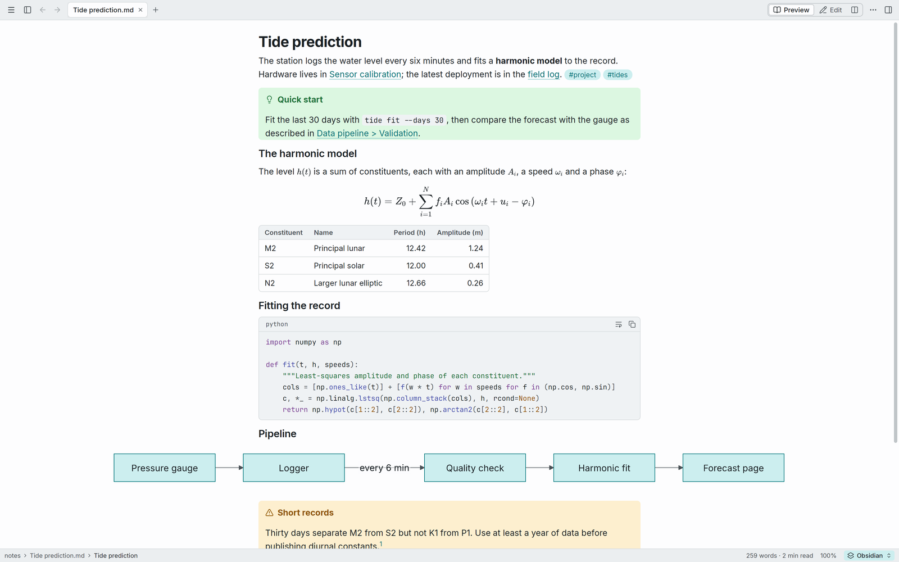

# Getting started

## Installing

Download Glyphvane from the
[GitHub Releases page](https://github.com/sorrelfox/glyphvane/releases). Pick
the file for your system and processor (`x86_64`/`amd64`/`x64` for most PCs,
`aarch64`/`arm64` for ARM). There are no macOS builds.

Each release also has a `SHA256SUMS` file to check your download, for example
with `sha256sum --check --ignore-missing SHA256SUMS` on Linux.

### Debian and Ubuntu (`.deb`)

```sh
sudo apt install ./glyphvane_<version>-1_amd64.deb
```

### Fedora, openSUSE and other RPM systems (`.rpm`)

```sh
sudo dnf install ./glyphvane-<version>-1.x86_64.rpm
```

The Linux builds need glibc 2.35 or newer (for example Ubuntu 22.04, Debian
12, Fedora 36 or later).

### Arch Linux

```sh
sudo pacman -U glyphvane-<version>-1-x86_64.pkg.tar.zst
```

### Flatpak

Install Glyphvane from its Flatpak repository:

```sh
flatpak install https://sorrelfox.github.io/glyphvane/glyphvane.flatpakref
flatpak run io.github.sorrelfox.Glyphvane
```

This adds the Glyphvane repository and, if it is missing, Flathub, which
supplies the freedesktop runtime. `flatpak update` then installs new
versions. The repository is signed; its key's fingerprint is
`B21B F785 DDEE CA61 883A 8E60 7BB1 AFE9 14F8 475F`.

You can also install the `.flatpak` bundle from the release page. It too
adds the Glyphvane repository, so it updates the same way. Add Flathub first
if you have not yet:

```sh
flatpak remote-add --user --if-not-exists flathub https://dl.flathub.org/repo/flathub.flatpakrepo
flatpak install --user Glyphvane-<version>-x86_64.flatpak
```

Glyphvane then also appears in your desktop's application list. The Flatpak
can read and write your home folder, so links between notes keep working
outside the opened folder (see [Privacy](privacy.md#flatpak-permissions) for
every permission). Flatpak keeps it up to date, so its own update check is
off. Its settings live in `~/.var/app/io.github.sorrelfox.Glyphvane/`.

### AppImage

```sh
chmod +x Glyphvane-<version>-x86_64.AppImage
./Glyphvane-<version>-x86_64.AppImage
```

If it does not start because FUSE is missing on your system, run it with
`--appimage-extract-and-run`.

### `.tar.gz` archive

```sh
tar -xzf glyphvane-<version>-x86_64-unknown-linux-gnu.tar.gz
./glyphvane-<version>-x86_64-unknown-linux-gnu/glyphvane
```

Keep `glyphvane-helper` (it makes PDFs and draws PDF pages) and the `share`
folder next to `glyphvane`. The archive does not add Glyphvane to your
application menu; the desktop file and icons are in `share/` if you want to
install them yourself.

### Windows (`.msi` or `.zip`)

The installer (`Glyphvane-<version>-windows-x64.msi`, or `-arm64.msi`)
installs Glyphvane for your user account, without administrator rights, into
`%LOCALAPPDATA%\Programs\Glyphvane`. It adds a Start menu entry, offers
Glyphvane in *Open with* for `.md` and `.markdown` files, and adds the
`glyphvane` command to your `PATH`.

The `.zip` archive needs no installation: extract it and run `glyphvane.exe`.
Keep `glyphvane-helper.exe` and the `share` folder next to it.

**SmartScreen.** If Windows shows "Windows protected your PC" when you start
the installer or the program, choose **More info** and then **Run anyway**.
See [Troubleshooting](troubleshooting.md#windows-says-windows-protected-your-pc).

## The first start

On the first start without files to open, a welcome window helps you set up
Glyphvane. Every choice applies at once and can be changed later in the
settings.

- **Start:** *Open folder…* opens a folder of notes or an Obsidian vault.
- **Theme:** System, Light, Semi-light or Dark.
- **Markdown flavor:** the profile used when Glyphvane cannot tell a
  document's flavor; see [Markdown and profiles](markdown-and-profiles.md).
- **Privacy:** the daily update check and local crash reports (both off until
  you turn them on), and whether to load remote images; see
  [Privacy](privacy.md).
- **Default app:** make Glyphvane the app that opens Markdown files. On
  Windows this opens the system's *Default apps* settings, where you make the
  choice.

**Get started**, **Esc** or closing the window ends the welcome; it does not
come back.

## Opening a file or a folder

- **A file:** File ▸ Open file…, drag it onto the window, open it from your
  file manager, or run `glyphvane notes.md`. It opens in a tab, in the
  Reading view (the **Open files in** setting can change that). A window
  opened for a file starts with the side panels hidden; show them with View
  ▸ Toggle sidebar.
- **A folder (a vault):** File ▸ Open folder… or `glyphvane ~/Notes`. The
  folder opens with the Files panel, and links, search, tags and backlinks
  work across all its files; see [Links and vaults](links-and-vaults.md).

A file you open on its own still belongs to a vault: Glyphvane takes the
nearest folder above it that contains `.obsidian`, `.glyphvane` or `.git`,
or else the file's own folder. That folder is indexed when you first show
the sidebar. Glyphvane asks before indexing your whole home folder, the root
of a drive, or a folder with more than 50,000 entries.

The first time you open a folder, Glyphvane asks whether to trust it; see
[Trust and remote content](links-and-vaults.md#trust-and-remote-content).

When you start Glyphvane without files, it restores the windows and tabs of
your last session. When it is already running, files you open go to its most
recent window as new tabs.

## The window



**Title row.** Buttons to show the sidebar and the right panel, back and
forward, the tabs, the mode switch (Preview, Edit, Split) and *More actions*
(**⋯**) for the active document. The menu button, which opens the
application menu (also on **F10**), is at the top left: at the head of the
sidebar, or of the title row when the sidebar is hidden. Right-click a tab for Close, Close others,
Close to the right, Copy path and Reveal. **Ctrl+W** closes a tab and
**Ctrl+Shift+T** reopens the last closed one.

**Sidebar** (left). The buttons at its top switch between **Files**,
**Search**, **Tags** and **Bookmarks**. Recent files, Sync conflicts and File
history open in the sidebar from the View and File menus.

**Right panel.** Sections for the active note that you can fold: the
**Outline**, **Backlinks** and **Links in this note**, and, when you ask for
them, the **Link checker** and a **Base**.

**Status bar** (bottom). At the left, the Git branch and where you are
(folder, file and the current heading). At the right, facts about the
document: in Preview the word count, reading time, link problems and zoom
level; in Edit and Split the line and column, word count, encoding and line
endings. At the far right is the document's
[flavor profile](markdown-and-profiles.md#the-profile-menu).

**Infobars** appear above the document when something needs your attention,
such as changes on disk or recovered text, with buttons for what you can do.

Use **F6** to move the keyboard between the sidebar, the document and the
right panel, and **Ctrl+P** to find any command by name.

## Next steps

- [Reading and editing](reading-and-editing.md)
- [Links and vaults](links-and-vaults.md)
- [Settings and shortcuts](settings-and-shortcuts.md)
