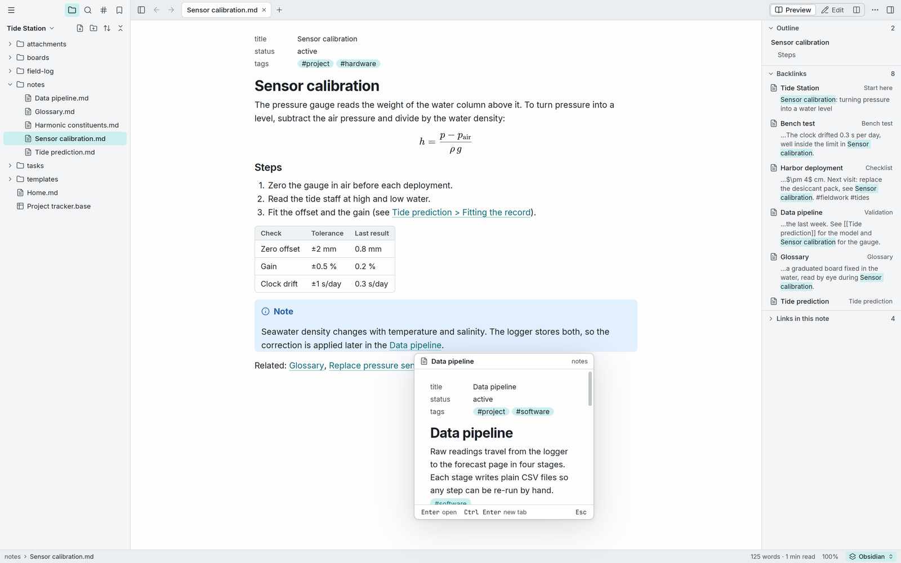

# Links and vaults

A **vault** is a folder of notes that you open as a whole (File ▸ Open
folder…, or `glyphvane <folder>`). In a vault, links resolve across all its
files, and the Files panel, backlinks, tags, search and the link checker work
on the whole folder. An Obsidian vault opens as it is; Glyphvane reads its
`.obsidian` settings where they matter (for example the attachment folder and
daily notes) and never changes them.

## Kinds of links

| You write | It links to |
|---|---|
| `[text](other.md)`, `[text](../notes/other.md)` | A file, relative to the current note |
| `[text](/notes/other.md)` | A file, from the root of the vault |
| `[text](other.md#a-heading)` | A heading in another note |
| `[[Other note]]` | A note by name (wikilink) |
| `[[Other note\|shown text]]` | The same, showing different text |
| `[[Other note#A heading]]` | A heading in another note |
| `[[#A heading]]` | A heading in the same note |
| `[[Other note#^block-id]]` | A block, marked with `^block-id` at the end of a paragraph or list item |
| `[text](file.pdf#page=3)` | A page of a PDF |
| `[text](https://example.org)` | A web page, opened in your browser |

Wikilinks, embeds and block IDs need a profile that supports them, such as
Obsidian or Extended; see [Markdown and profiles](markdown-and-profiles.md).

**How names are found.** A link starting with `./` or `../` is relative to
the note it is in, and one starting with `/` starts at the root of the vault.
A bare name such as `[[Ideas]]` is looked up across the vault. `.md` may be
left out. If the exact name is not found, Glyphvane also accepts a match that
differs only in letter case or Unicode form (the link checker reports those
as warnings). When several notes have the same name, Glyphvane prefers the one
whose letter case matches exactly, then the one in fewer folders, then the
shorter path.

- Following a link to a note that does not exist offers **Create note**.
- Following an ambiguous link opens the best match and tells you how many
  notes match, with **Choose…** and **Rewrite link**.
- When the vault is a Git repository, web links to its own files on GitHub or
  GitLab (such as `https://github.com/owner/repo/blob/main/docs/x.md`) open
  the local file instead. `obsidian://open` links open the local file too.

### Embeds

In profiles with embeds, `![[…]]` shows another file in the note:

| You write | What you see |
|---|---|
| `![[Other note]]` | The other note, rendered in place (nested up to 5 levels) |
| `![[Other note#A heading]]`, `![[Other note#^block-id]]` | Only that section or block |
| `![[picture.png]]` | The image |
| `![[picture.png\|300]]`, `![[picture.png\|300x200]]` | The image at that width (and height) |
| `![[document.pdf#page=3]]` | A card with **Open in PDF viewer**, which opens that page |
| `![[board.canvas]]` | The canvas; click it to open it |
| `![[tasks.base]]`, `![[tasks.base#View name]]` | A live view of the base |
| `![[recording.mp3]]` | An audio player; see [PDF and media](pdf-and-media.md) |

Standard Markdown images (``) work in every profile.
Embedding files from outside the vault is off unless you allow it in the
settings (Privacy and security).

### Following links

| Where | Click | Ctrl+click | Ctrl+Alt+Shift+click | Middle click |
|---|---|---|---|---|
| Reading view | Opens the link in this tab | Opens it in a new tab | Opens it in a new window | Opens it in a background tab |
| Editor | Places the cursor | Opens the link in this tab | Opens it in a new window | Opens it in a background tab |

**Ctrl+Alt+Shift+click** opens a new window the same way on canvas cards,
rows and links in bases, search results, query blocks and hover previews.

From the keyboard, put the cursor on a link and press **Alt+Enter** to follow
it, or **Ctrl+Alt+Enter** to open it in a new tab. A right-click on a link
opens the link menu: open in a new tab or window, copy the link, the resolved
path or the URL, reveal the target in the file tree or the file manager, show
how the link was resolved, and **Fix link…**. **Alt+Left** and **Alt+Right**
take you back and forward.

Web links open in your default browser. In Restricted mode (see
[below](#trust-and-remote-content)), Glyphvane asks before opening them. With
the **confirm_web_links** setting (Settings ▸ Links), it asks before the
first link to each site; once you open one, other links to that site open
without asking until you quit Glyphvane.
Glyphvane never starts programs from notes: links to programs and launchers
are only shown in the file manager.

## Hover previews

In the Reading view, rest the pointer on a link to see a preview of its target
(after 300 ms by default; the delay is a setting). In the editor, hold
**Ctrl** while pointing at the link, or put the cursor on it and run *Preview
link under caret* from the command palette.

- A note shows its rendered text, scrolled to the heading or block.
- An image shows the image.
- A web link shows its address; nothing is downloaded.
- A missing note offers **Create note**; an ambiguous link lists the
  candidates.

In a preview, **Enter** opens the target, **Ctrl+Enter** opens it in a new
tab and **Esc** closes the preview. Previews can open previews, two levels
deep.

## Backlinks, outgoing links and unlinked mentions

The right panel (View ▸ Toggle right panel) shows, for the active note:

- **Outline:** its headings; see
  [Search and navigation](search-and-navigation.md#outline).
- **Backlinks:** every note that links here, grouped by note, with the line
  around each link. Embeds, links from front matter and links through an
  alias are labelled.
- **Unlinked mentions:** places where other notes mention this note's title,
  file name or aliases as plain text. **Link** turns a mention into a link
  (one undoable edit).
- **Links in this note:** the note's own links, each with its status, and how
  many have errors or warnings.

In Preview, the status bar shows the number of link problems in the note;
click it to see *Links in this note*.

## Renaming, moving and deleting

Use the File menu, or right-click a file in the Files panel:

- **Rename…** checks the new name as you type.
- **Move to…** asks for a folder. You can also drag a file onto a folder in
  the Files panel.
- **Duplicate** makes a copy named `Name 1.md` next to the original.
- **Move to trash** asks first and tells you how many links will break. The
  file goes to the system trash (the Recycle Bin on Windows).

When a rename or move changes links in other notes, Glyphvane first shows a
list of every link before and after; press **Enter** to apply it. Links keep
their style (wikilink or Markdown, relative or not), and the file's
[version history](files-and-safety.md#version-history) moves with it.
Afterwards an infobar offers **Undo**, which reverts the move and every link
change in one step. Links in HTML (`<a href="Note.md">`) are updated too,
written as URLs (`My%20Note.md`), although, as in Obsidian, they do not
count as links: they are not backlinks and the link checker skips them.

To rename a heading or a block ID and update every link to it, put the cursor
on it in the editor and run **Rename heading or block ID** from the command
palette. Links in other notes, embeds, HTML links, canvas cards and
`link("Note#Heading")` in bases are updated the same way, with a preview
and **Undo**. A heading written over several lines (underlined with `===`
or `---`) becomes one line.

Files with unsaved changes cannot be renamed or moved; save them first.

## The link checker

The link checker finds broken links before your readers do. Open it with
View ▸ Link checker, or run *Check links in this note*, *Check links in this
folder* or *Check links in the vault* from the command palette. It opens in
the right panel, with a switch for the scope (Note, Folder or Vault).

| Severity | Findings |
|---|---|
| Error | The target does not exist; the heading or block does not exist; the link is blocked |
| Warning | Several notes match; the match differs in letter case or Unicode form; a loose match; the target is outside the vault; the link works differently under another profile; the name is not valid on Windows |
| Info | A wikilink names another note's alias |

Many findings offer a fix: correct the letter case, rewrite the link to one
of the candidates, point it to the note that has the alias, or create the
missing note. The same checks run from the command line with
[`glyphvane check-links`](command-line.md#glyphvane-check-links).

## Attachments and drag and drop

**Pasting an image** into a note saves it as `Pasted image
YYYYMMDDHHMMSS.png` in the attachment folder and embeds it. The note must be
saved first. The attachment folder is the one set in Obsidian's settings
(`.obsidian/app.json`) when there is one, otherwise the **attachment folder**
setting: `/` (the default) is the vault root, `./` is the note's own folder,
and `./name` a subfolder of it.

**Dragging and dropping:**

| Drag | Onto | Result |
|---|---|---|
| Files from your file manager | A folder in the Files panel | Copied into that folder |
| Files from your file manager | The editor | A link to each file. Files inside the vault are linked where they are; files from outside are copied into the attachment folder or linked, as the **external files** setting says (copy, link, or ask each time, the default) |
| A file from the Files panel | The editor | A link to it; hold **Alt** to embed it instead |
| A heading from the Outline | The editor | A link to that heading |
| Files | The Reading view or the tab bar | Opens them |

Images, audio, video and PDFs are embedded; other files are linked.

## Trust and remote content

The first time you open a folder, Glyphvane asks **Trust the files in this
folder?** and lists what its notes could do: load images and media from the
web, open links in other apps, and bring CSS snippets, themes, plugins and
shared settings.

- **Trust**, with a choice for remote content:
  - **Allow** loads images and media from the web (it still asks for
    addresses on your own computer or local network);
  - **Ask** (the default) shows a bar in each note that references remote
    content;
  - **Block** never loads it.
- **Restricted mode** blocks all remote content, confirms every link that
  leaves the app, and ignores plugin highlighters and CSS snippets.
- Closing the prompt decides nothing; it comes back next time.

Your choice is stored in Glyphvane's own data folder, never inside the vault.
Change it later in Settings (**Ctrl+,**) ▸ Privacy and security, with the
settings scope switched to the vault.

When a note references remote content and the mode is Ask, an infobar says
which sites, with **Load once** (this note, this session), **Always allow this
site**, **Allow for this vault** and **Block this site**. Remote content is
only loaded in the Reading view. See also [Privacy](privacy.md).
