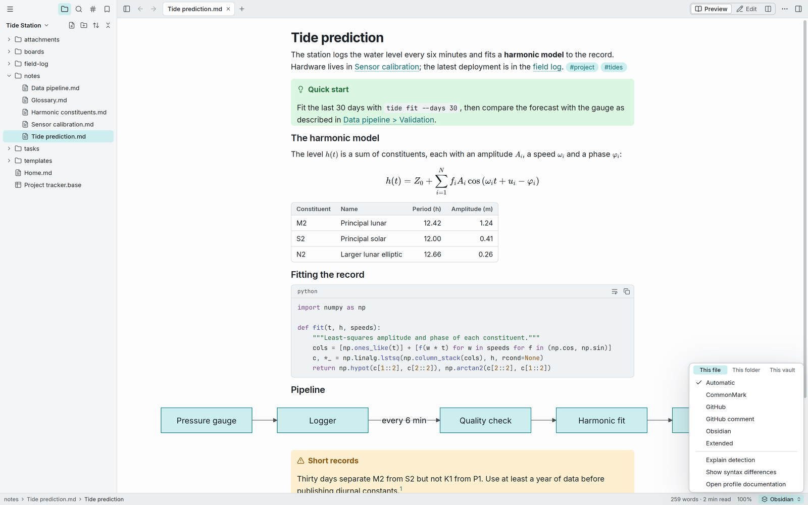

# Markdown and flavor profiles

Markdown comes in flavors: GitHub, Obsidian and others each add their own
syntax, and they disagree on details such as line breaks or `~tilde~`. Each
document in Glyphvane is rendered by a **flavor profile**, so it looks the way
its flavor defines it. The profile of the active document is shown in the
status bar.



## The profiles

| Profile | ID | Use it for |
|---|---|---|
| **CommonMark** | `commonmark` | Plain, strictly standard Markdown |
| **GitHub** | `gfm-file` | Files in GitHub repositories (README files, docs) |
| **GitHub comment** | `gfm-comment` | Text written for GitHub issues and comments, where a single line break is kept |
| **Obsidian** | `obsidian` | Obsidian vaults |
| **Extended** | `extended` | Everything else: GitHub's syntax plus wikilinks, highlights and more. The default |

The IDs are used on the [command line](command-line.md) and in
[`.glyphvane.toml`](#glyphvanetoml-files).

### What each profile supports

| Syntax | CommonMark | GitHub | GitHub comment | Obsidian | Extended |
|---|---|---|---|---|---|
| Tables | – | ✓ | ✓ | ✓ | ✓ |
| Task lists `- [ ]` | – | ✓ | ✓ | ✓ (any mark) | ✓ |
| `~~strikethrough~~` | – | ✓ | ✓ | ✓ | ✓ |
| `~text~` | as typed | strikethrough | strikethrough | as typed | subscript |
| Front matter | – | YAML | YAML | YAML | YAML and TOML (`+++`) |
| `> [!NOTE]` | quote | alert | alert | callout | alert |
| Footnotes `[^1]` | – | ✓ | ✓ | ✓, also inline `^[…]` | ✓, also inline `^[…]` |
| Math | – | ✓ | ✓ | ✓ | ✓ |
| Mermaid diagrams | – | ✓ | ✓ | ✓ | ✓ |
| `==highlight==` | – | – | – | ✓ | ✓ |
| `[[wikilinks]]` and `![[embeds]]` | – | – | – | ✓ | ✓ |
| `%%comments%%`, `#tags`, `^block-ids` | – | – | – | ✓ | – |
| `:emoji:` shortcodes | – | ✓ | ✓ | – | ✓ |
| Bare `www.` and `https://` links | – | ✓ | ✓ | ✓ | ✓ |
| A single line break is kept | – | – | ✓ | ✓ | – |
| `@mentions`, `#123` and colour chips | – | – | ✓ | – | – |

In Obsidian vaults whose settings turn on *Strict line breaks*, the Obsidian
profile follows that setting.

**Extended only:** `^superscript^`, `++inserted text++`, definition lists,
abbreviations (`*[HTML]: HyperText Markup Language`), fenced divs (`:::`),
attributes (`{#id .class}`), a `[TOC]` paragraph for a table of contents, and
extra information on code fences (a title, highlighted lines, line numbers).

## What renders

- **Tables**, with column alignment. Wide tables fit the text column or grow
  beside it.
- **Task lists**, with checkboxes.
- **Footnotes**, numbered in the order they are first referenced and listed
  at the end of the document. Go ▸ Go to footnote or back jumps between a
  reference and its footnote.
- **Callouts** (Obsidian): `> [!tip] Title`, with a custom title, folding
  (`> [!tip]+` starts open, `> [!tip]-` starts closed) and nesting. The types
  are note, abstract (also summary, tldr), info, todo, tip (hint, important),
  success (check, done), question (help, faq), warning (caution, attention),
  failure (fail, missing), danger (error), bug, example and quote (cite).
  Unknown types look like a note.
- **Alerts** (GitHub): `> [!NOTE]`, `[!TIP]`, `[!IMPORTANT]`, `[!WARNING]` and
  `[!CAUTION]`. Format ▸ Insert callout… inserts whichever the profile has.
- **Math:** `$…$` inline and `$$…$$` as a block in every profile with math.
  The two GitHub profiles and Extended also accept `` $`…`$ `` and
  ` ```math ` blocks. `\newcommand` and `\def` work within a document, and chemical
  formulas with mhchem (`\ce{…}`). A formula with an error shows its source
  below the message.
- **Mermaid diagrams** in ` ```mermaid ` blocks: flowchart, sequence, class,
  state, entity relationship, Gantt, pie, user journey, Git graph, mind map,
  timeline, quadrant, requirement, C4, Sankey, XY chart, block, packet, kanban
  and architecture diagrams. A diagram type that is not recognised shows its
  source.
- **Code blocks** with syntax highlighting for many languages (Rust, Python,
  JavaScript, TypeScript, Go, C, C++, C#, Java, Kotlin, Swift, shell, SQL,
  YAML, TOML, LaTeX and others). The colours follow the app theme, or the
  **Code theme** setting.
- **Front matter** is shown as a list of properties at the top; `tags` show
  as tags.
- **Embeds** of notes, images, PDFs, canvases, bases and audio; see
  [Links and vaults](links-and-vaults.md#embeds).
- **HTML:** `<details>` and `<summary>` (a section that folds), `<picture>`
  (the picture for the current light or dark theme), and a single `<audio>`,
  `<video>` or `<iframe>` (a card; nothing is loaded from the web). Other raw
  HTML is shown as its source text.
- **Emoji shortcodes** (`:tada:`) are drawn as emoji in the Reading view, in
  Live Preview and in exports, and offered by autocomplete, in profiles that
  have them. In other profiles they stay as typed.

## How the profile is chosen

Glyphvane picks the profile for each document automatically. From the most
important to the least:

1. A profile you chose for **this file** in the profile menu.
2. The nearest [`.glyphvane.toml`](#glyphvanetoml-files) file that sets a
   profile.
3. A profile you chose for **this folder** (the nearest folder wins), then
   for **this vault**.
4. The file extension: `.mdx`, `.qmd` and `.rmd` files.
5. The nearest tool configuration above the file: an `.obsidian` folder means
   Obsidian; `mkdocs.yml`, `docusaurus.config.*`, `_quarto.yml`, `.vitepress`,
   `hugo.toml` and `_config.yml` (Jekyll) are recognised too.
6. The Git remote: a repository on `github.com` means GitHub.
7. The default profile (the **Default profile** setting, Extended unless you
   change it).

Dialects that have no profile of their own yet (such as MkDocs, Quarto or
Hugo) use Extended, and the status bar names what was detected. Front matter
is never used to choose the profile.

In the settings (Profiles), **Default profile** is the fallback, and **Vault
profile** sets one profile for the whole vault (*Detect* means automatic).

Sometimes a note uses syntax of another flavor, for example `!!!` admonitions
or `[[_TOC_]]`. When Glyphvane sees at least two such signs, it asks whether
to switch the profile.

## The profile menu

Click the profile name in the status bar to open its menu:

- **This file**, **This folder** and **This vault** choose what your choice
  applies to.
- **Automatic** and the five profiles: pick one to override the detection.
  Overrides chosen here last until you quit; for a lasting choice, use a
  `.glyphvane.toml` file or the Vault profile setting.
- **Explain detection** shows which profile applies and why, any switch
  overrides, and errors in configuration files.
- **Show syntax differences** lists every setting where the current profile
  differs from the others, for example `wikilinks: on` with "GitHub off ·
  CommonMark off" beside it. Rows changed by a `.glyphvane.toml` file are
  marked. Type to filter the list.
- **Open profile documentation** opens the flavor's own reference in your
  browser.

## `.glyphvane.toml` files

To fix the profile for a folder and everything below it, and share that
choice through Git, create a file named `.glyphvane.toml` in the folder.
Glyphvane reads it but never writes it; the nearest one above a file applies.

```toml
profile = "obsidian"     # commonmark, gfm-file, gfm-comment, obsidian or extended
root = true              # this folder is the root of a vault

[switches]               # optional: fine-tune single syntax features
smart_punctuation = true
tilde_single = "strike"
```

| Key | Value |
|---|---|
| `profile` | A profile ID |
| `root` | `true` or `false`: whether this folder is a vault root |
| `[switches]` | Overrides for single syntax features, applied on top of whichever profile is chosen (except a profile chosen for one file) |

The switch names are `soft_break`, `raw_html`, `html_markdown`, `tables`,
`table_min_dashes`, `task_lists`, `refdef_max_indent`, `front_matter_yaml`,
`front_matter_toml`, `admonitions`, `footnotes`, `footnote_indent`,
`inline_footnotes`, `definition_lists`, `abbreviations`, `fenced_divs`,
`attributes`, `toc_marker`, `fence_meta`, `mermaid`, `math`, `math_brackets`,
`slugs`, `tilde_single`, `tilde_double`, `superscript`, `highlight`, `insert`,
`wikilinks`, `embeds`, `wiki_pipe`, `comments`, `tags`, `block_ids`, `emoji`,
`extended_autolinks`, `github_references`, `colour_chips` and
`smart_punctuation`. *Show syntax differences* shows each switch with its
value in every profile, which tells you what values it takes.

Mistakes do not stop the file from working: an unknown key is ignored with a
warning, a wrong value ignores only that key, and a TOML syntax error makes
the whole file count as empty. *Explain detection* shows these problems.

A shared settings file can also live in a vault, at `.glyphvane/settings.toml`;
see [Settings and shortcuts](settings-and-shortcuts.md#settings-for-one-vault).
