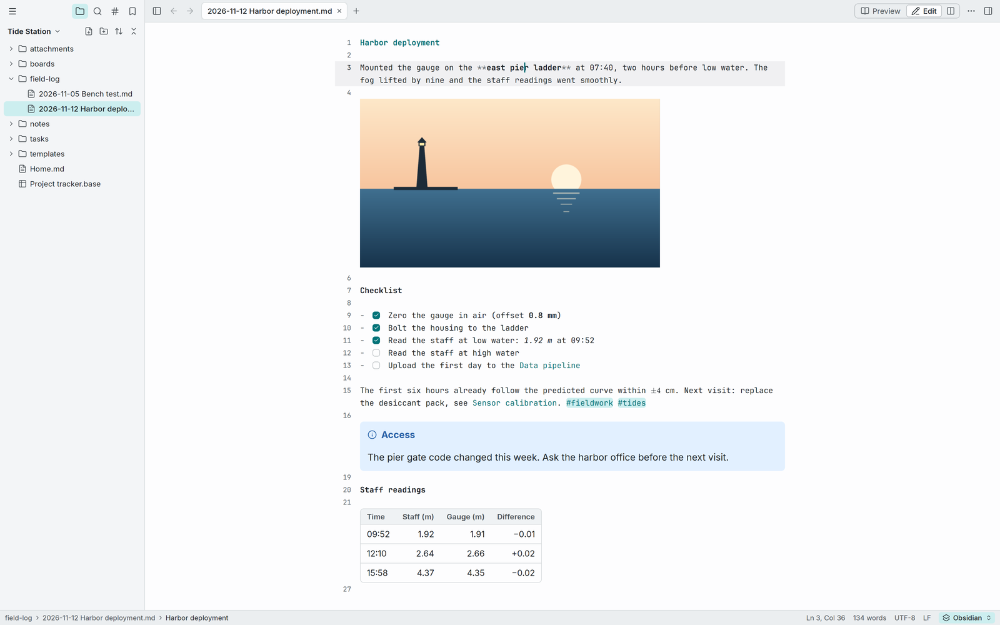

# Reading and editing

Each tab shows its document in one of three modes:

| Mode | What you see | How to get there |
|---|---|---|
| **Preview** | The rendered document (the Reading view) | View ▸ Preview |
| **Edit** | The Markdown source in the editor, optionally with [Live Preview](#live-preview) | View ▸ Edit |
| **Split** | The source and the preview side by side, scrolling together | View ▸ Split |

The mode switch in the title row changes the mode too. **Ctrl+E** toggles
between Preview and Edit, and **Ctrl+Alt+E** toggles the Split view. In Split
view you can drag the divider between the two sides.

**Viewer mode.** To protect documents from accidental edits, turn on
*Viewer mode* in Settings ▸ General. Documents then open read-only, and Edit
and Split are unavailable (untitled notes and files opened with `--wait` stay
editable). View ▸ Viewer mode (also in the title row's **⋯** menu and the
command palette) switches viewer mode for the current tab only: turn it off
to edit one document while the setting is on, or on to protect one document
while the setting is off. The tab keeps that choice until you close it, also
when Glyphvane starts again with your last session. The **Open files in**
setting chooses whether files you open from
your file manager or the command line start in Preview, in the editor, or in
the mode you used last.

Shortcuts in this guide use **Ctrl**. They are the same on Linux and Windows;
macOS is not supported. You can change any of them, see
[Settings and shortcuts](settings-and-shortcuts.md).

## The Reading view

The Reading view renders the document according to its
[flavor profile](markdown-and-profiles.md). Scroll with the mouse wheel or the
keyboard: the arrow keys, Page Up and Page Down, Space, Home and End.

- Click a link to follow it, or hover over it to see a preview; see
  [Links and vaults](links-and-vaults.md).
- Select text and copy it with **Ctrl+C**. Edit ▸ Copy as Markdown copies the
  Markdown source of the selection, and Edit ▸ Copy as rich text copies it as
  formatted text for word processors and mail programs.
- Wide tables, diagrams and math fit the text column, or grow beside it.
- **Ctrl+F** finds text in the document; **F3** and **Shift+F3** go to the
  next and previous match.

## Live Preview

Live Preview is an editing style for Edit mode that looks almost like the
Reading view while you type. Turn it on with View ▸ Live Preview. Each tab
remembers whether it uses Live Preview, also across restarts; new tabs start
with the plain source.

**Markers hide away from the cursor.** The markup of bold, italic,
strikethrough, highlights, inline code, comments, links and wikilinks is
hidden. When the cursor or a selection touches a piece of markup, its markers
appear so you can edit them. A heading's `#` marks appear while the cursor is
anywhere on the heading's line. The cursor moves over hidden markers in one
step, so it never stops inside them.

**Inline widgets** are drawn in the text line:

- images, as a small thumbnail (local images inside the vault or the note's
  folder; other images show their alt text);
- inline math (`$…$`);
- task checkboxes: click one to tick or untick the task (one undoable edit);
- emoji shortcodes, in profiles that have emoji;
- tags: click one to search the vault for that tag.

Click an image, a formula or an emoji to put the cursor inside it and edit
its source.

**Block widgets** are drawn like in the Reading view, for blocks at the top
level of the note (not inside lists or quotes): code blocks, diagrams, tables,
display math (`$$`), callouts, horizontal rules, front matter (shown as
properties), and a paragraph that holds only an image or an embed.

- A block shows its source while the cursor or a selection is inside it. Click
  a block, or move into it with the Up and Down keys, to edit it.
- An image on its own line keeps its picture below the source line while you
  edit it.
- To follow a link inside a block, **Ctrl+click** it. Hovering shows the
  link's preview, and a right-click opens the link menu.

Live Preview is not available for text and code files, or for very large
files.

## Writing Markdown

### Lists, quotes and tasks

| Key | What it does |
|---|---|
| **Enter** | New line that continues the list or quote: the next number, a new bullet, or a new `[ ]` for task lists. On an empty item it outdents a nested item or ends the list |
| **Shift+Enter** | New line without continuing the list |
| **Tab** / **Shift+Tab** | Nest or un-nest a list item, or add or remove a quote level |
| **Ctrl+L** | Toggle a task (`- [ ]` and `- [x]`) |

Format ▸ Renumber list fixes the numbers of an ordered list.

### Formatting

| Key | Command |
|---|---|
| **Ctrl+B** | Bold |
| **Ctrl+I** | Italic |
| **Ctrl+Shift+X** | Strikethrough |
| **Ctrl+Shift+H** | Highlight |
| **Ctrl+Shift+C** | Inline code |
| **Ctrl+K** | Insert link |
| **Ctrl+Alt+1** … **Ctrl+Alt+6** | Heading 1 to 6 |
| **Ctrl+Alt+0** | Paragraph |
| **Ctrl+Shift+.** | Quote |
| **Ctrl+/** | Toggle comment |

The Format menu also has Insert callout…, Insert footnote, Insert or format
table and Insert template…. Commands that the document's flavor profile does
not support are greyed out; for example, CommonMark has no strikethrough,
highlights or task boxes.

**Smart pairs.** Typing `(`, `[`, `{`, `"` or a backtick adds the closing
character. With a one-line selection, these characters and `*` and `_` (and
`~` and `=` where the flavor has them) wrap the selection. Typing the closing
character steps over it, and Backspace between a pair deletes both. Smart
pairs are off inside code and front matter.

### Tables

- **Tab** and **Shift+Tab** move to the next or previous cell, select its text
  and tidy up the table's columns. Tab in the last cell adds a row.
- Format ▸ Insert or format table creates a table, or lines up the columns of
  the table at the cursor. Its shortcut is **Ctrl+Alt+T** on Windows; on
  Linux it has none, because most desktops use that key to open a terminal.
- Right-click inside a table for more: insert or delete rows and columns, move
  them, set a column's alignment, and sort the table by a column.

### Lines and selections

| Key | Command |
|---|---|
| **Alt+Up** / **Alt+Down** | Move the line up or down |
| **Shift+Alt+Right** / **Shift+Alt+Left** | Expand or shrink the selection |
| **Ctrl+Z** / **Ctrl+Shift+Z** or **Ctrl+Y** | Undo / redo |
| **Ctrl+Shift+V** | Paste as plain text |

The Edit menu also has Duplicate line, Join lines, Sort lines and Change case.
In the command palette you find every other editing command.

### Multiple cursors

- **Alt+click** adds a cursor; **Alt+drag** selects a column.
- **Shift+Alt+Up** / **Shift+Alt+Down** add a cursor above or below on Linux;
  on Windows the keys are **Ctrl+Alt+Up** / **Ctrl+Alt+Down**.
- In the find bar, **Alt+Enter** turns every match into a cursor.

### Folding

You can fold heading sections, list items with more than one block, code
blocks, quotes, front matter and HTML blocks. Use View ▸ Fold, Unfold, Fold
all and Unfold all, or the command palette for *Fold to heading level 1* to
*6*. In Split view, the gutter shows arrows to fold and unfold; click the
`⋯` marker of a folded block to unfold it.

### Find and replace

| Key | What it does |
|---|---|
| **Ctrl+F** | Find in the document |
| **Ctrl+H** | Find and replace |
| **F3** / **Shift+F3** | Next / previous match |

The find bar has toggles for **Match case**, **Whole word** and **Regular
expression**. Replace all is a single undo step. With regular expressions,
the replacement can use groups as `$1` or `${name}`. To search all files of
a vault, use **Ctrl+Shift+F**; see
[Search and navigation](search-and-navigation.md).

### Autocomplete

Suggestions appear as you type:

| Type | Suggests |
|---|---|
| `[[` or ` or as the character.

### Smart paste

- Pasting a URL over selected text makes a link.
- Pasting formatted text from a web page or word processor (HTML on the
  clipboard) converts it to Markdown.
- **Ctrl+Shift+V** pastes the plain text instead.

To paste images and drop files into notes, see
[Links and vaults](links-and-vaults.md#attachments-and-drag-and-drop).

### Spell check

Misspelled words are underlined. Right-click one for suggestions and for
**Add to dictionary**, **Add to vault dictionary** (only in a vault) and
**Ignore** (for this session). Go ▸ Next misspelling jumps to the next one.

- American English (`en_US`) is built in. To add a language, put a Hunspell
  dictionary pair (`.aff` and `.dic`) in the `dictionaries` folder of your
  settings folder (see
  [where settings are stored](settings-and-shortcuts.md#where-settings-are-stored)),
  then choose it in the settings.
- Words you add go to `dictionaries/words.txt` in the settings folder; vault
  words are kept for that vault only.
- A `lang` property in a note's front matter sets the language of that note.
- Settings: Spell check on or off, the languages, and whether to skip words
  with digits and words in capitals.

## Text and code files

Files that are not Markdown (Markdown means `.md`, `.markdown`, `.mdown`,
`.mkd`, `.mkdn`, `.mdwn` and `.mdx`), canvases or bases open as plain text.
They first show in a read-only text viewer, with syntax highlighting when the
language is known; switch to Edit to change them. In this plain-text mode
folding, autocomplete, smart pairs, smart paste and link handling are off, and
spell check stays on only for prose formats (`.txt`, `.text`, `.rst`, `.adoc`,
`.asciidoc` and `.org`). Code files use a monospace font.

## Soft wrap and whitespace

Long lines wrap at the window edge (soft wrap) by default. View ▸ Soft wrap
turns it off and on, and View ▸ Show whitespace shows spaces and tabs.

## Zoom

Zoom makes the document text larger or smaller, in Preview, Edit and Split,
from 50 % to 300 % in steps of 10 %. It applies to all documents and is kept
between launches. The interface itself keeps its size; to change that, see
[Accessibility](accessibility.md#interface-size).

| Key | Command |
|---|---|
| **Ctrl+=** or **Ctrl++** | Zoom in |
| **Ctrl+-** | Zoom out |
| **Ctrl+0** | Reset zoom |
| **Ctrl+mouse wheel**, or pinch | Zoom in or out |

In Preview, the status bar shows the zoom level; click it for a menu of levels
(50 % to 300 %) with Zoom in, Zoom out and Reset zoom.
