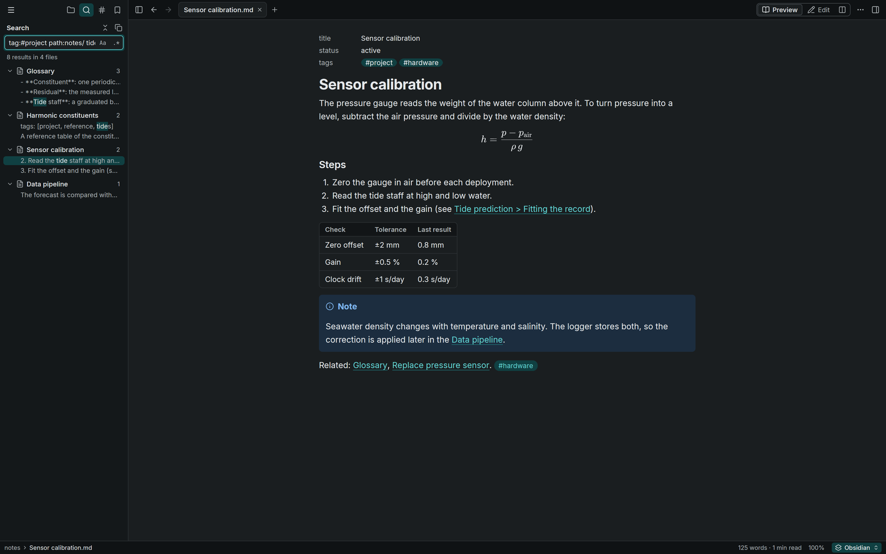
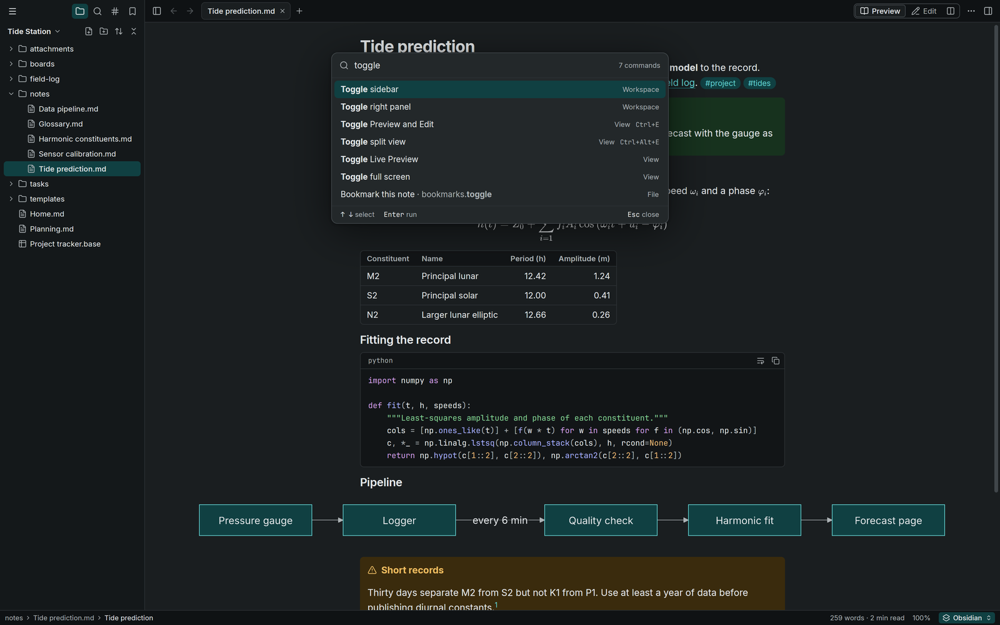

# Search and navigation

## Searching the vault

Press **Ctrl+Shift+F** (Edit ▸ Search in vault) to open the Search panel in
the sidebar. If you have selected text on one line, it becomes the query.



- Results are grouped by note: notes whose name or title matches come first,
  then notes with the most matches for their size, then the most recently
  changed.
- Click a match to open the note there. **Ctrl+click** opens it in a new tab,
  **Ctrl+Alt+Shift+click** in a new window, a middle click in a background
  tab.
- From the keyboard: **Up** and **Down** move, **Enter** opens, **Ctrl+Enter**
  opens in a new tab, **Left** and **Right** fold and unfold a note's matches,
  and **Esc** returns to the document.
- Two toggles next to the query: **Aa** matches letter case, and **.\***
  treats the whole query as one regular expression.
- The panel's header can fold all results and copy the results as a list of
  Markdown links.

A search stops after 2,000 matching notes, and counts up to 200 matches in
each note.

### Query syntax

Words next to each other must all match (AND). A word matches the text of a
note or its file name. Letter case is ignored unless you ask for it.

| Syntax | Meaning | Example |
|---|---|---|
| `word other` | Both words, anywhere in the note or its name | `fox dog` |
| `"exact phrase"` | The exact phrase (`\"` for a quote inside it) | `"quick brown"` |
| `OR` | Either side; must be in capitals. AND binds tighter, so `a b OR c` means `(a b) OR c` | `meeting OR call` |
| `-term` | Leave out notes that match. A dash inside a word (`well-known`) is just text | `fox -dog` |
| `( … )` | Grouping | `-(draft OR old) report` |
| `/regex/` | A regular expression; `^` and `$` match at each line. `\/` is a slash | `/^Met with/` |
| `file:` | The file name only | `file:2026-` |
| `path:` | The path inside the vault | `path:projects -file:old` |
| `content:` | The note's text only, not its name | `content:budget` |
| `tag:` | A tag (the `#` is optional). Also finds nested tags, so `tag:#animals` finds `#animals/dog` | `tag:#project` |
| `line:( … )` | All terms on the same line | `line:(quick fox)` |
| `block:( … )` | All terms in the same block (paragraph, list or code block) | `block:(budget 2026)` |
| `section:( … )` | All terms in the same section (from one heading to the next) | `section:(fox dog)` |
| `task:` | Task lines | `task:report` |
| `task-todo:` | Open tasks (`[ ]`) | `task-todo:report` |
| `task-done:` | Tasks with any other mark, such as `[x]` | `task-done:review` |
| `match-case:` | Match letter case for the next term | `match-case:API` |
| `ignore-case:` | Ignore letter case for the next term | `ignore-case:file:Readme` |
| `[name]` | The note has the front matter property `name` | `[due]` |
| `[name:null]` | The property is empty | `[status:null]` |
| `[name:value]` | The property's value (or one of its list items) contains `value`; the value can be any query | `[status:(done OR draft)]`, `[status:-done]` |
| `[name:>5]` | Compare the property with `<`, `<=`, `>`, `>=` or `=`. Numbers compare as numbers, everything else as text | `[priority:>2]`, `[due:<2026-06-01]` |

More details:

- Operators can be combined and nested: `line:(fox -quick)`,
  `ignore-case:file:X`, `file:(alpha OR beta)`.
- Operator names ignore case (`PATH:` works), and an unknown prefix such as
  `http:` is searched as ordinary text.
- `task:""` lists every task in the vault.
- A property name with spaces goes in quotes: `["my prop":"a b"]`.
- Tags inside code are never found.
- The query never fails: an unclosed bracket or quote runs to the end of the
  query.

A ` ```query ` code block in a note lists the notes its query finds, each
with its matching lines, in the Reading view. Click a note to open it, or
one of its lines to open the note at that line.

## Quick switcher

Press **Ctrl+O** to jump to any file in the vault by name. Type parts of the
name in any order; `proj/read` finds `Projects/Readme.md`. The list includes:

- every file, with its title;
- aliases, shown as "Alias → Note";
- notes that links point to but that do not exist yet;
- open tabs, unsaved notes and recent files (these rank higher).

| Key | What it does |
|---|---|
| **Enter** | Open the file; on a note that does not exist yet, or when nothing matches, create it |
| **Shift+Enter** | Create a note named after what you typed, also in folders (`Projects/Plan`); a bare name goes to the vault's default location for new notes (Obsidian's *Files and links* setting) |
| **Ctrl+Enter** | Open in a new tab |

Start the query with `#` to list headings, or `^` to list block IDs, across
all notes.

## Command palette

Press **Ctrl+P** or **Ctrl+Shift+P** to run any command by name. The palette
lists the commands that can run where you are, with their shortcuts; with an
empty query, the commands you ran recently come first.



## Go to line, heading and page

| Key | Command | You type |
|---|---|---|
| **Ctrl+G** | Go to line (in the editor) | A line number, or `line:column` (`line,column` works too) |
| **Ctrl+Shift+O** | Go to heading | Part of a heading |
| **Ctrl+G** | Go to page (in the PDF viewer) | A page number |

The view follows as you type; **Esc** returns to where you were. Go ▸ Go to
footnote or back jumps between a footnote reference and its footnote.

## Outline

The Outline section of the right panel shows the headings of the active
document, with the current section highlighted. Click a heading to go there.
Drag a heading into the editor to insert a link to it.

## Tags

The Tags panel in the sidebar lists the vault's tags as a tree (nested tags
such as `#project/alpha` appear under `#project`), with the number of notes
for each. Click a tag, or press **Enter**, to search for it. **Ctrl+F**
filters the list, and you can sort by name or by number of notes.

## Bookmarks

File ▸ Bookmark (*Bookmark this note* in the palette) adds the active note to
the Bookmarks panel, or removes it. In an Obsidian vault, Obsidian's own
bookmarks are listed too, under "From Obsidian" (read-only); they can include
headings, blocks, searches and web links.

## Recent files and folders

File ▸ Open recent… (or View ▸ Recent) lists the folders and files you opened
recently, newest first. It has a button to clear the list.

## Back and forward

Each tab keeps its own history of the places you went to by following links,
outline entries and the like (scrolling does not count).

| Key | Command |
|---|---|
| **Alt+Left** | Go back |
| **Alt+Right** | Go forward |
| **Ctrl+Shift+T** | Reopen the last closed tab |

The back and forward buttons are in the title row, and in the Go menu.

## Moving between panes

**F6** and **Shift+F6** move the keyboard focus to the next or previous part of
the window (sidebar, document, right panel). View ▸ Toggle sidebar and Toggle
right panel show and hide the side panels.

## Daily notes

Go ▸ Today's note opens the note for today, and creates it if needed; Previous
daily note and Next daily note move between existing daily notes.

Glyphvane uses the Daily notes settings of an Obsidian vault
(`.obsidian/daily-notes.json`: folder, date format and template). Without
them, daily notes go in the vault root, are named `YYYY-MM-DD.md`, and start
empty.

## Templates

Format ▸ Insert template… inserts a template at the cursor. Templates are the
notes in the template folder set in Obsidian's Templates settings
(`.obsidian/templates.json`), or else in a `Templates` or `templates` folder at
the vault root.

| Variable | Becomes |
|---|---|
| `{{title}}` | The note's name |
| `{{date}}` | Today's date (`YYYY-MM-DD` unless Obsidian's Templates settings say otherwise; in a daily note, that note's date) |
| `{{time}}` | The time (`HH:mm` unless set otherwise) |
| `{{date:FORMAT}}`, `{{time:FORMAT}}` | The date or time in your own format, with Moment.js tokens such as `dddd, D MMMM YYYY` |

Variable names ignore case. Templater plugin syntax is not run.
